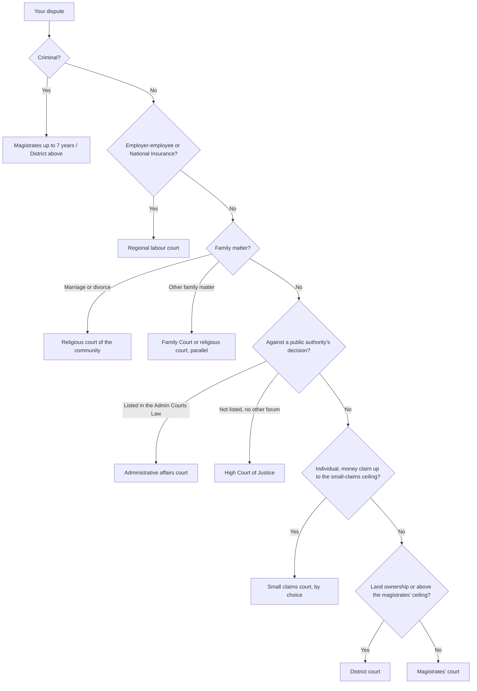

# 01.4 · The court map: courts, tribunals and jurisdiction

By the end of this lesson you will be able to take a dispute, decide which Israeli court or tribunal has the power to hear it, pick the right city, and avoid the most expensive beginner's mistake: filing in a forum that has no jurisdiction and losing months (and sometimes a limitation period) before starting again.

## Why it matters

Israel has one general court system in three tiers, a parallel system of labour courts, specialised courts that sit inside the general system (family, small claims, local affairs, administrative), religious courts for each recognised community, military courts, and dozens of tribunals and appeals committees set up by particular laws. Jurisdiction (סמכות) is the legal power of a forum to decide a type of case. A judgment given without jurisdiction can be void, as the rabbinical court learned in Amir (below).

There are two separate questions every time:

1. **Subject-matter jurisdiction (סמכות עניינית):** which kind of court. This is set by statute and the parties cannot change it by agreement.
2. **Territorial jurisdiction (סמכות מקומית):** which city's court of that kind. This is set by procedure rules and is more flexible.

## Key terms

| עברית | Transliteration | English |
|---|---|---|
| סמכות עניינית | samkhut inyanit | subject-matter jurisdiction |
| סמכות מקומית | samkhut mekomit | territorial jurisdiction (venue) |
| סמכות ייחודית | samkhut yihudit | exclusive jurisdiction |
| סמכות מקבילה | samkhut makbila | parallel (concurrent) jurisdiction |
| בית משפט השלום | beit mishpat ha-shalom | magistrates' court |
| בית המשפט המחוזי | beit ha-mishpat ha-mehozi | district court |
| בג״ץ | bagatz | High Court of Justice (the Supreme Court sitting as such) |
| בית הדין לעבודה | beit ha-din la-avoda | labour court |
| בית דין דתי | beit din dati | religious court (rabbinical, Sharia, Christian, Druze) |
| סעד חלופי | sa'ad halufi | alternative remedy (a reason for the HCJ to decline) |

## The law

### Who judges: Basic Law: The Judiciary, s. 1

> (א) אלה בתי המשפט שסמכות שפיטה נתונה בידיהם: (1) בית המשפט העליון; (2) בית משפט מחוזי; (3) בית משפט שלום; (4) בית משפט אחר שנקבע בחוק כבית משפט; [...]
> (ב) סמכות שפיטה נתונה גם בידי אלה: (1) בית דין דתי; (2) בית דין אחר; (3) רשות אחרת והכל כפי שנקבע בחוק.
> (ג) לא יוקם בית משפט או בית דין למקרה מיוחד.

*Gist:* Judicial power belongs to the Supreme, district and magistrates' courts and other courts set by law, and also to religious courts, other tribunals and authorities as the law provides; no court may be set up for a single case. [Full text, s. 1](https://he.wikisource.org/wiki/חוק-יסוד:_השפיטה#סעיף_1)

### The magistrates' court: Courts Law s. 51

> (א) בית משפט שלום ידון באלה: (1)(א) עבירות שעונשן קנס בלבד או מאסר לתקופה שאינה עולה על שבע שנים; [...] (2) תביעות אזרחיות – למעט תביעות הנוגעות למקרקעין – כשסכום התביעה או שווי הנושא אינו עולה על 2,500,000 שקלים חדשים ביום הגשת התובענה [...] (3) תביעות בדבר חזקה או שימוש במקרקעין [...]

*Gist:* The magistrates' court hears offences punishable by up to seven years, civil claims up to a monetary ceiling (other than claims concerning land), and claims about possession or use of land of any value. [Full text, s. 51](https://he.wikisource.org/wiki/חוק_בתי_המשפט#סעיף_51) The current ceiling is in [current numbers](../../references/current-numbers.md).

### The district court: Courts Law s. 40

> בית משפט מחוזי ידון באלה: (1) כל עניין אזרחי או פלילי שאיננו בסמכותו של בית משפט שלום; [...] (1א) עתירה מינהלית, ערעור מינהלי, תובענה מינהלית [...] (3) ערעורים על פסקי דין ועל החלטות אחרות של בתי משפט השלום;

*Gist:* The district court hears everything not within the magistrates' court's jurisdiction (including land ownership disputes and large claims), sits as the administrative affairs court, and hears appeals from the magistrates' courts. [Full text, s. 40](https://he.wikisource.org/wiki/חוק_בתי_המשפט#סעיף_40)

### Small claims: Courts Law s. 60

> (א) בית משפט לתביעות קטנות ידון בתביעה אזרחית שהגיש יחיד – (1) לתשלום סכום שאינו עולה על 30,000 שקלים חדשים [...]

*Gist:* The small claims court hears civil claims filed by an individual (not a company) for money, or for replacement, repair or cancellation of a purchase, up to a ceiling that is updated periodically. [Full text, s. 60](https://he.wikisource.org/wiki/חוק_בתי_המשפט#סעיף_60) The statutory figure is linked to an index; the updated ceiling is in [current numbers](../../references/current-numbers.md).

Appeal from small claims is by leave of a district court judge only (s. 64).

### The High Court of Justice: Basic Law: The Judiciary, s. 15(ג)

> בית המשפט העליון ישב גם כבית משפט גבוה לצדק; בשבתו כאמור ידון בענינים אשר הוא רואה צורך לתת בהם סעד למען הצדק ואשר אינם בסמכותו של בית משפט או של בית דין אחר.

*Gist:* The Supreme Court also sits as the High Court of Justice, granting relief for the sake of justice in matters that are not within the jurisdiction of another court or tribunal. [Full text, s. 15](https://he.wikisource.org/wiki/חוק-יסוד:_השפיטה#סעיף_15)

The last words make the HCJ a residual forum. If an administrative court, a labour court or an appeals committee can hear the matter, the HCJ will usually send you there ("סעד חלופי").

### Labour courts: Labour Court Law s. 24

> (א) לבית דין אזורי תהא סמכות ייחודית לדון – (1) בתובענות בין עובד או חליפו למעסיק או חליפו שעילתן ביחסי עבודה, לרבות השאלה בדבר עצם קיום יחסי עבודה [...]

*Gist:* Regional labour courts have exclusive jurisdiction over claims between employees and employers arising from employment, including whether an employment relationship exists at all, and over many National Insurance matters. [Full text, s. 24](https://he.wikisource.org/wiki/חוק_בית_הדין_לעבודה#סעיף_24)

### Family and religious courts

> עניני נישואין וגירושין של יהודים בישראל אזרחי המדינה או תושביה יהיו בשיפוטם היחודי של בתי דין רבניים.

*Gist:* Marriage and divorce of Jews who are Israeli citizens or residents are in the exclusive jurisdiction of the rabbinical courts. [Rabbinical Courts Jurisdiction Law, s. 1](https://he.wikisource.org/wiki/חוק_שיפוט_בתי_דין_רבניים_%28נישואין_וגירושין%29#סעיף_1)

> (א) עניני משפחה לפי חוק זה יידונו בבית המשפט לעניני משפחה.

*Gist:* "Family matters" as defined in the Act (personal-status claims and civil claims between family members arising from a family dispute) are heard in the Family Court. [Family Court Law, s. 3](https://he.wikisource.org/wiki/חוק_בית_המשפט_לעניני_משפחה#סעיף_3)

For other communities, the Order in Council gives the Sharia courts exclusive jurisdiction over Muslims' personal status (art. 52) and the recognised Christian communities' courts exclusive jurisdiction over marriage, divorce and maintenance (art. 54); the Druze Religious Courts Law gives the Druze court exclusive jurisdiction over Druze marriage and divorce (s. 4). Since a 2001 amendment (s. 3(ב1) of the Family Court Law), the Family Court may also hear the family matters of Muslims and Christians other than marriage and divorce. [Order in Council](https://he.wikisource.org/wiki/דברי_המלך_במועצה_על_ארץ-ישראל#סעיף_52); [Druze courts law](https://he.wikisource.org/wiki/חוק_בתי_הדין_הדתיים_הדרוזיים#סעיף_4)

### Where in the country: Civil Procedure Regulations, reg. 7

> (א) תובענה תוגש לבית המשפט המצוי במחוז שיפוט של מקום מגוריו או מקום עסקו של הנתבע או במקום המעשה או המחדל שבשלו תובעים, ואם היתה התובענה במקרקעין תוגש לבית המשפט שבמחוז שיפוטו הם מצויים; [...]

*Gist:* File where the defendant lives or does business, or where the act or omission occurred; a claim about land goes to the court where the land is. Reg. 7(ב) adds that a claim over publication or trade on the internet may also be filed where the plaintiff lives or does business (with a limit for business plaintiffs suing consumers). [Full text, reg. 7](https://he.wikisource.org/wiki/תקנות_סדר_הדין_האזרחי#סעיף_7)

## Leading cases

### בג״ץ 8638/03 סימה אמיר נ׳ בית הדין הרבני הגדול בירושלים, פ״ד סא(1) 259 (2006)

A divorcing couple agreed that the rabbinical court would decide a property claim between them. The Supreme Court held that a rabbinical court is a statutory body with only the jurisdiction the law gives it; the parties' consent cannot expand that jurisdiction, and the rabbinical court may not act as an arbitrator in civil matters outside it. Its decisions on the claim were void.

Why it matters: subject-matter jurisdiction cannot be created by agreement. Before you agree to "let the rabbinical court (or any forum) decide everything", check that it has jurisdiction over each claim. [English translation](https://larc.cardozo.yu.edu/iscp-opinions/49)

### בג״ץ 3914/92 לב נ׳ בית הדין הרבני האזורי בתל-אביב-יפו (1994)

A rabbinical court ordered a wife not to leave the country during divorce proceedings. The Supreme Court, sitting as the HCJ, held that religious courts have inherent power to manage their procedure but must exercise it reasonably and respect basic rights; the court lacked authority to issue that order without a well-founded concern that leaving would frustrate the proceedings.

Why it matters: religious courts sit inside the Israeli legal system. The HCJ supervises their jurisdiction (Basic Law: The Judiciary s. 15(ד)(4)) and their compliance with basic principles, though not the merits of religious law. [English translation](https://larc.cardozo.yu.edu/iscp-opinions/234)

## How it works in practice

### The map at a glance

The chart simplifies. Check the statute for your exact case, especially for tribunals that a specific law creates (for example appeals committees for National Insurance or planning matters).

**Step 1: classify the dispute.** Criminal, civil, labour, family, administrative or a specialised field. A dispute can have parts in two forums: a dismissed worker may have a labour claim against the employer and a separate tort claim against a co-worker.

**Step 2: check exclusive jurisdiction first.** Labour (s. 24), marriage and divorce (religious courts), family matters (Family Court, or parallel religious court jurisdiction), and matters a specific statute sends to a tribunal. If an exclusive forum exists, no other forum may hear the claim.

**Step 3: civil claims by value and subject.** Up to the small-claims ceiling and filed by an individual: small claims court is available but optional (s. 61 preserves the right to file in the magistrates' court). Up to the magistrates' ceiling: magistrates' court. Land ownership or above the ceiling: district court. Possession or use of land: magistrates' court, whatever the value.

**Step 4: public authorities.** The Administrative Courts Law lists in its schedules which decisions go to the administrative affairs court (s. 5). Anything else that only a court of justice can review goes to the HCJ, after you have written to the authority and waited for an answer.

**Step 5: venue.** Under reg. 7, file where the defendant lives or does business, or where the act or omission happened; land claims where the land is; internet trade or publication claims also where you live. If the parties signed an agreement on venue, reg. 7(א) sends the claim to the agreed court (a venue clause in a consumer standard contract may itself be challenged, module 3). For several defendants, any of their venues works (reg. 7(ג)).

**Step 6: the "race".** Where the Family Court and a religious court both have jurisdiction (for example maintenance or property in divorce), the forum seised first may keep the matter. People sometimes rush to file first. This is a strategic decision with lasting effects; it is a signal to get advice.

**What it costs.** Court fees depend on the forum and the amount claimed; they are listed, with sources, in [current numbers](../../references/current-numbers.md) as modules add them.

## Worked example

Three disputes from the Cohen-Abu Ras household in Ramla.

1. **Maya Cohen's employer** paid her no overtime for a year and then dismissed her. She also wants to sue the company for damaging her car in its car park. The overtime and dismissal claims are "בין עובד למעסיק שעילתן ביחסי עבודה": exclusive jurisdiction of the regional labour court (s. 24(א)(1)). The car damage is a tort claim; s. 24(א)(1) excludes claims based on the Civil Wrongs Ordinance, so it goes to the small claims court or magistrates' court by value.
2. **Maya's brother Eitan** is divorcing. The divorce itself (the get) is in the rabbinical court's exclusive jurisdiction. Child support and custody could be heard in the Family Court or, if properly joined to the divorce claim, in the rabbinical court. He should not agree, as in Amir, to let the rabbinical court decide a property dispute it has no jurisdiction over.
3. **Maya's neighbour, Samir Abu Ras**, wants to challenge the municipality's refusal to give his daughter a place in the nearby kindergarten. Local-authority decisions in education matters are listed in the Administrative Courts Law's first schedule (item "חינוך"), so the likely forum is the administrative affairs court in the district court; he must first write to the municipality and allow it to answer. If the decision type were not listed, the HCJ would be the forum.

## Do it yourself

### You need

- Your inventory from lesson 01.1.
- The [forum check worksheet](../../templates/forum-check-worksheet.md).
- The statutes linked in this lesson.
- 60 minutes.

### Steps

1. Choose three disputes from your inventory, ideally of different types (consumer, employment, family, authority).
2. For each, fill in part A of the worksheet: parties, what you want, amount, where events happened.
3. Run the flow above. Write the forum you land on and the section that gives it jurisdiction (copy the Hebrew words).
4. Check for exclusive jurisdiction elsewhere. If any part of the dispute belongs to a different forum, split it and list both.
5. Choose the venue under reg. 7, naming which connection you rely on (defendant's residence, business, or place of the act).
6. For the authority dispute, decide between the administrative affairs court and the HCJ, and note the first written demand you would send.

### Template

[Forum check worksheet](../../templates/forum-check-worksheet.md) (Hebrew, part A and part B).

### How you know it worked

- Every dispute ends with a named forum, a section number and a venue.
- No dispute is sent to two forums for the same claim.
- Employment claims went to the labour court; marriage and divorce to a religious court.

### Self-check

- [ ] I can state the magistrates' court's civil jurisdiction in one sentence, with the current ceiling from current numbers.
- [ ] I know why the HCJ often refuses a petition when an administrative court could hear it.
- [ ] I can explain what Amir teaches about agreeing to a forum.
- [ ] I can apply reg. 7 to pick a city.

## Without a lawyer

### Can you do this yourself?

Yes. Choosing the forum is part of preparing your own case. Every court listed here accepts a self-represented individual; companies may need a lawyer (lesson 01.1). See [Can I act without a lawyer?](../../references/can-i-act-without-a-lawyer.md).

### Where and how

> [!IMPORTANT]
> Act in your own name only. This is not legal advice — check current rules before filing.

- The Judiciary's information centre and the court secretariats answer procedural questions (not legal advice).
- Small claims, magistrates' and labour courts accept filings from unrepresented parties; online filing through Net HaMishpat (נט המשפט) for unrepresented parties is covered in module 8.
- Family matters: the Welfare Ministry's assistance units at family and religious courts offer intake and mediation (see [where to get help](../../references/where-to-get-help.md)).
- Fees and ceilings: [current numbers](../../references/current-numbers.md).

### Stop and get a lawyer when

- A family dispute could be heard in a religious court or the Family Court and the other side has already filed or threatened to.
- The claim concerns ownership of land, or is near the magistrates' ceiling and could move to the district court.
- You are not sure whether a tribunal set by a specific law has exclusive jurisdiction, and a deadline is running.
- You are considering an HCJ petition (module 6 covers a dry run).

## What goes wrong

| Mistake | Consequence | How to fix | How to avoid |
|---|---|---|---|
| Suing an employer for unpaid wages in the magistrates' court | Claim struck out or transferred; months lost | Ask the court to transfer it under Courts Law s. 79 | Check s. 24 before filing any work-related claim |
| Agreeing that a religious court will decide a civil claim outside its jurisdiction | Decision void, as in Amir | Petition or start again in the right forum | Check jurisdiction claim by claim; consent cannot create it |
| Filing in your own city when the defendant and the events are elsewhere | Venue objection, transfer, delay | Ask for transfer under the procedure rules | Apply reg. 7 before filing |
| Going straight to the HCJ | Petition dismissed for an alternative remedy or no prior demand | Use the administrative court or the authority's own appeal | Check the Administrative Courts Law schedules first; send a demand |
| A company filing in small claims | Claim rejected: only an individual may file | File in the magistrates' court | Read s. 60: "שהגיש יחיד" |

## Review

- Jurisdiction has two layers: subject matter (set by statute, cannot be changed by agreement) and venue (procedure rules).
- Magistrates' courts hear most civil claims up to a ceiling and land possession cases; district courts hear the rest, appeals and administrative matters; the Supreme Court hears appeals and sits as the HCJ.
- Labour courts have exclusive jurisdiction over employment claims; religious courts over marriage and divorce; the Family Court over other family matters, sometimes in parallel with religious courts.
- The HCJ is residual: it acts where no other court or tribunal can.
- Amir: consent cannot give a religious court jurisdiction. Lev: religious courts are supervised by the HCJ.

### Learn more

- Amir v. Great Rabbinical Court, English translation. FREE-FULL, about 45 minutes: [Cardozo Israeli Supreme Court Project](https://larc.cardozo.yu.edu/iscp-opinions/49). Fallback: search "8638/03" at https://supremedecisions.court.gov.il.
- Courts Law, chapter 2 (ss. 25–67), read for structure. FREE-FULL, about 30 minutes: [Wikisource](https://he.wikisource.org/wiki/חוק_בתי_המשפט#פרק_ב).
