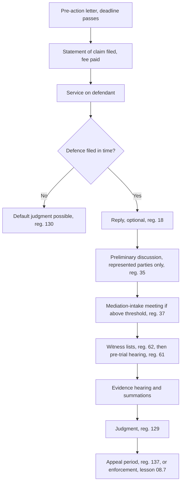

# 08.2 · The life of a civil case: pre-action letter, statement of claim, defence, preliminary hearing, trial, judgment

This lesson follows one civil claim from the first letter to the final judgment in a magistrates' court, stage by stage, with the regulation that governs each step and the deadline you must diary. By the end you will be able to draw the timeline of your own case and write pleadings in the shape the 2018 Regulations demand.

## Why it matters

The 2018 Regulations moved the hard work to the start of a case. Pleadings are short and structured, documents are attached at once, facts not expressly denied are treated as admitted, represented parties must meet and exchange documents before the first court hearing, and most claims above a threshold go to a free mediation-intake meeting. A party who treats the statement of claim as a rough first draft, or the defence as a formality, can lose before any witness is heard.

Two policy debates sit behind these rules. First, **front-loading**: early disclosure and page limits save court time, but they demand work and money before anyone knows whether the case will settle. Second, **deemed admission** (reg. 14(ב)): it forces defendants to engage with the facts instead of a blanket denial, but it can be harsh on an unrepresented defendant who did not know that silence means admission. Courts soften it with the power to allow amendment; you should not rely on that.

## Key terms

| עברית | Transliteration | English |
|---|---|---|
| מכתב התראה / מכתב דרישה | michtav hatra'a / michtav drisha | pre-action (warning) letter, demand letter |
| כתב תביעה | ktav tvi'a | statement of claim |
| כתב הגנה | ktav hagana | statement of defence |
| כתב תשובה | ktav tshuva | reply |
| המצאה | hamtza'a | service of documents |
| פסק דין בהעדר הגנה | psak din be'heder hagana | default judgment |
| דיון מקדמי | diyun mukdam | preliminary discussion between the parties |
| פגישת מהו״ת | pgishat mahut | mediation-intake meeting (information, acquaintance, coordination) |
| קדם משפט | kdam mishpat | pre-trial hearing |
| דיון מהיר | diyun mahir | fast track |

## The law

### Before the claim: there is no general pre-action duty

The 2018 Regulations do not require a pre-action letter. Reg. 9(א) simply says a proceeding opens with a statement of claim:

> הליך בבית משפט ייפתח בהגשת כתב תביעה, שבמענה לו יוגש כתב הגנה.

*Gist:* A case begins with a statement of claim, answered by a defence. ([reg. 9(א)](https://he.wikisource.org/wiki/תקנות_סדר_הדין_האזרחי))

A letter is still good practice for three reasons. Costs reflect "the parties' conduct" (reg. 151(א)), and a court may take account of a plaintiff who sued without warning a defendant who would have paid. The letter fixes dates for interest and for the other side's knowledge. And it often ends the dispute. Some laws do require prior notice: a petition to the Administrative Affairs Court must attach the prior demand to the authority or explain why there was none ([admin. regs, reg. 5(ב)(6)](https://he.wikisource.org/wiki/תקנות_בתי_משפט_לענינים_מינהליים_(סדרי_דין)); lesson 08.5), and a creditor who wants the Execution Office to enforce a fixed-sum debt without a judgment must first send a warning by registered mail ([Execution Law s. 81א1(ב1)](https://he.wikisource.org/wiki/חוק_ההוצאה_לפועל); lesson 08.7).

### The statement of claim: three parts, page limits

> (ג) כתב תביעה וכתב הגנה יכללו שלושה חלקים לפי הסדר המפורט להלן: (1) כותרת; (2) תמצית הטענות; (3) פירוט הטענות.

*Gist:* Every claim and defence has a heading, a summary of the arguments and a detailed statement. ([reg. 9(ג)](https://he.wikisource.org/wiki/תקנות_סדר_הדין_האזרחי))

In a magistrates' court the summary may not exceed two pages and the detail nine pages (reg. 9(ד)); district-court limits are a little longer. The heading lists, in order, the court, your name and ID number, your address and contact details, the defendant's details as far as you can find them, whether a party is a minor or a company, the type of claim from the courts' list, every remedy and its value, the court fee and the fee item, and any related proceeding (reg. 10). The summary states, briefly, the parties, the remedy, the facts that found the cause of action and when it arose, and the facts that give the court jurisdiction (reg. 11). Attach the material documents the claim rests on (reg. 15(א)(1)).

### The defence: time, structure, deemed admission

> (ב) כתב הגנה יוגש בתוך שישים ימים ממועד המצאת כתב התביעה לידי הנתבע…

*Gist:* The defence is due within the defence period from service (medical-negligence cases have a longer one); the court may extend for good reason. ([reg. 9(ב)](https://he.wikisource.org/wiki/תקנות_סדר_הדין_האזרחי); periods in [current numbers](../../references/current-numbers.md))

> (ב) הנתבע ייחשב מודה בכל העובדות הכלולות בכתב התביעה, זולת אלה שהכחיש באופן מפורש ומפורט בחלקו השלישי של כתב ההגנה…

*Gist:* A defendant is treated as admitting every fact in the claim that the defence does not deny expressly and in detail; damages are treated as disputed unless expressly admitted. ([reg. 14(ב)](https://he.wikisource.org/wiki/תקנות_סדר_הדין_האזרחי))

The defence's summary starts with preliminary arguments (lack of jurisdiction, limitation, an arbitration clause), then the answer to each cause of action, then arguments on the remedy (reg. 13). The plaintiff may file a short reply within a short period (reg. 18; see [current numbers](../../references/current-numbers.md)). If no defence is filed in time, the court may ask for proof or give judgment on the claim alone (reg. 130); a defendant who was absent may apply to set the decision aside within 30 days of service (reg. 131; see current numbers).

### Service for unrepresented parties: reg. 160

A represented party's lawyer serves copies on the other side. A party "not represented by a lawyer" files the document with the court's registry, "which will act to serve it" (reg. 160). Electronic filing to the court goes through Net HaMishpat (reg. 161(1)(ב)).

### Before trial: preliminary discussion, mediation intake, pre-trial

> (א) בתוך שלושים ימים ממועד המצאת כתב הטענות האחרון ינהלו בעלי הדין, זולת בעל דין שאיננו מיוצג בידי עורך דין, דיון מקדמי…

*Gist:* Represented parties must hold a preliminary discussion soon after the last pleading, to narrow issues, consider alternative dispute resolution and exchange documents; a party without a lawyer is exempt. ([reg. 35](https://he.wikisource.org/wiki/תקנות_סדר_הדין_האזרחי))

Above a set claim value (and except personal-injury and road-accident claims), the court's mediation unit appoints a mediator for a free information-and-coordination meeting (פגישת מהו״ת), "whether or not the party is represented" (reg. 37(ב)). Attendance is compulsory; a party who does not come pays the mediator's and the other side's costs (reg. 37(י)). Agreeing to mediation itself remains voluntary (Courts Law s. 79ג(ב); lesson 08.6). Thresholds and periods: [current numbers](../../references/current-numbers.md).

The pre-trial hearing (קדם משפט) is set after the pleadings close (reg. 61(א)). The judge may order the parties to attend in person; a hearing by video with an unrepresented party needs that party's consent (reg. 61(ג)). The plaintiff files a list of witnesses before the first pre-trial, with a short note on why each is needed; the defendant follows (reg. 62).

### Trial, judgment, appeal

The court decides whether main evidence is given orally or by affidavit, preferring oral testimony where it helps find the truth (reg. 67(א)); then come cross-examination and re-examination (reg. 67(ג)). A plaintiff who does not appear without reasonable cause has the claim struck out; if the defendant does not appear, the plaintiff may prove the claim (reg. 75). Judgment comes as soon as possible and, at first instance, within 90 days of the end of the hearing or the judge must report to the court's president (reg. 129). An appeal is due within 60 days of service of the judgment (reg. 137(א); see [current numbers](../../references/current-numbers.md)).

### The fast track: regs 78–82

Most money claims up to a ceiling (excluding class actions, road-accident and personal-injury claims) and claims to evict a tenant go to the fast track (reg. 78). Each party attaches an affidavit verifying its pleading and a list of relevant documents (reg. 79); the defence period is shorter, the pre-trial is held soon after, and trial follows within months (reg. 80). Ceiling and periods: [current numbers](../../references/current-numbers.md).

## Leading cases

### Key text: the Regulations themselves

The 2018 Regulations are recent, and the free English-language sources do not yet include a leading Supreme Court decision on regs 9–14 that the course could open. The text is the authority for this lesson; read regs 9–15 and 34–39 in full on [Wikisource](https://he.wikisource.org/wiki/תקנות_סדר_הדין_האזרחי). When you research a point, search Net HaMishpat decisions for the regulation number in quotation marks (lesson [02.2](../module-02/lesson-02.md)) and check the date: a decision under the 1984 rules may not apply.

### רע״א 8120/08 (recap)

Recap from lessons 01.6 and 08.1: no lay representative. In practice this is why the Regulations build special rules for unrepresented parties (exemption from the preliminary discussion, service by the registry, consent to video pre-trial) instead of letting friends act for them. (⚠️ manual check of the decision text on the Judiciary's site.)

## How it works in practice

### The timeline in a magistrates' court (ordinary track)

### Filing in practice

- **Online.** The Judiciary's service pages for a statement of claim in ordinary procedure and for a defence describe filing through Net HaMishpat after logging in ([claim](https://www.gov.il/he/service/ordinaty-procedure-filing-a-statement-of-claim), [defence](https://www.gov.il/he/service/filing-letter-of-defense); ⚠️ manual check: gov.il blocks automated access, and the pages are written mainly for lawyers). Whether an unrepresented plaintiff can open a regular civil case online on a given day: ask the information centre (lesson 08.8).
- **At the registry.** You may always file in person at the court's registry, with copies for the court and each defendant, and pay the fee there or by voucher.
- **Fee.** A claim for a fixed sum in the magistrates' court pays a percentage of the claim with a minimum (see [current numbers](../../references/current-numbers.md)); an exemption may be requested for inability to pay.
- **Time.** An ordinary case takes many months to years; the fast track aims at months.

### Writing pleadings that work

- **Numbered paragraphs, one fact each,** dated, in the first person, each with its exhibit.
- **The summary is your case in two pages.** A judge reads it first and may read nothing else before the pre-trial.
- **In a defence, deny line by line.** "Paragraph 4 is denied: the goods were returned on 3.3.2026, see exhibit 2." A general "all facts are denied unless admitted" is not an express and detailed denial (reg. 14(ב)).
- **Plead every remedy.** The heading must list all remedies and their value (reg. 10(9)); and a claim must seek the full remedy for one cause of action, or you may lose the rest (reg. 25).

## Worked example

Tamar Levi, a freelance translator from Rishon LeZion, did a ₪14,000 translation job for "פרסום הים התיכון בע״מ". The company paid ₪4,000 and stopped answering.

1. **Pre-action letter (day 0).** She sends a letter by email and registered mail: the order, the invoice, the amount due, a 14-day deadline, and a statement that she will sue for the balance with interest and costs (template in lesson 08.8).
2. **No reply (day 21).** Her ₪10,000 claim is under the small-claims ceiling, so she could choose small claims (lesson 08.3). She chooses small claims. Had the company owed her more than the ceiling, the claim would go to the magistrates' court on the fast track (reg. 78), because it is a money claim under the fast-track ceiling.
3. **In the magistrates' court version** she would file a heading (reg. 10), a one-page summary (reg. 11) and a three-page detail (reg. 14), attach the order, the invoice, the emails and the letter (reg. 15), and an affidavit and list of documents (reg. 79, fast track). The registry would serve the company (reg. 160).
4. **The company's defence** says only "the work was defective". Tamar notes that it does not deny the order, the price or the part payment: those facts are admitted (reg. 14(ב)). The dispute narrows to quality.
5. **Pre-trial.** Tamar is unrepresented, so there is no preliminary discussion (reg. 35(א)). She attends in person; the judge proposes a compromise at ₪8,500. She has decided in advance that anything above ₪8,000 is acceptable and agrees, and the settlement is given the force of a judgment (Courts Law s. 79א(ב); lesson 08.6).

## Do it yourself

### You need

- A civil dispute of your own over a sum of money, or the supplied case from lesson 08.1 (Noa Ben-David and the moving company).
- Regs 9–15, 35–37, 61–62 and 78–80 open in another window.
- About an hour.

### Steps

1. **Draw your timeline (15 min).** Copy the flowchart and write, next to each box, the regulation and the deadline from [current numbers](../../references/current-numbers.md). Mark which steps you would skip as an unrepresented party.
2. **Track and intake (10 min).** Is the claim fast track (reg. 78)? Would a mediation-intake meeting be appointed (reg. 37(ב))? Write yes or no with the reason.
3. **Heading (10 min).** Draft the heading in Hebrew in the order of reg. 10, with "[to check]" where you do not know a detail.
4. **Summary (15 min).** Write the reg. 11 summary in at most one page: parties, remedy, the facts that found the cause of action and the date it arose, the facts that give the court jurisdiction.
5. **Defence check (10 min).** Imagine the defence. Write three numbered denials that would satisfy reg. 14(ב), and one that would not.

### Template

- [Pre-action letter (מכתב התראה לפני הגשת תביעה)](../../templates/pre-action-letter.md) for the letter that opens the timeline (full lab in 08.8).
- [Demand letter to a company](../../templates/demand-letter-company.md) if your dispute is with a business and you have not written yet.

### How you know it worked

- Every box on your timeline has a regulation and a date.
- Your heading follows reg. 10 in order and lists every remedy with its value.
- Your summary fits on one page and states when the cause of action arose.
- You can say why each of your denials is "express and detailed".

### Self-check

- [ ] I know the defence period and what happens if no defence is filed.
- [ ] I know that facts not denied in detail are admitted.
- [ ] I know which pre-trial steps apply to me as an unrepresented party.
- [ ] I know when the appeal period starts to run.

## Without a lawyer

> [!IMPORTANT]
> Act in your own name only. This is not legal advice — check current rules before filing.

### Can you do this yourself?

Yes. An individual may file and defend a civil claim in the magistrates' or district court personally (reg. 170). The Regulations adapt several steps for you: no compulsory preliminary discussion (reg. 35(א)), service through the registry (reg. 160), and video pre-trial only with your consent (reg. 61(ג)). A company usually needs a lawyer (see [can I act without a lawyer](../../references/can-i-act-without-a-lawyer.md)).

### Where and how

- The magistrates' court for the venue set by reg. 7 (lesson [01.4](../module-01/lesson-04.md)).
- Filing: the court registry in person, or Net HaMishpat where the case type allows unrepresented filing (⚠️ manual check; lesson 08.8).
- Fee, defence period, fast-track ceiling, mediation-intake threshold and appeal period: [current numbers](../../references/current-numbers.md).
- Free help: court volunteer desks, the information centre, Legal Aid where eligible ([where to get help](../../references/where-to-get-help.md)).

### Stop and get a lawyer when

- The claim is in the district court, involves land, personal injury, or a sum that matters to your finances.
- The defendant files a motion to strike out, a counterclaim, or a third-party notice.
- You missed a deadline (defence, appeal) and need an extension or to set aside a default judgment.
- Expert evidence is needed (a construction defect, a medical question).

## What goes wrong

| Mistake | Consequence | How to fix | How to avoid |
|---|---|---|---|
| Suing without any letter | Possible effect on costs; a dispute that might have settled goes on | Send a letter now and offer to discuss | Always send a pre-action letter with a deadline |
| Twelve-page "summary" | Order to amend; delay | File an amended pleading within the limits | Write to reg. 9(ד) from the start |
| Defence that denies "everything" in one line | Facts deemed admitted (reg. 14(ב)) | Ask leave to amend quickly, with reasons | Deny paragraph by paragraph with your version |
| Missing the defence period | Default judgment (reg. 130) | Apply to set aside within 30 days (reg. 131) with an affidavit and a defence | Diary the date of service, not the date you read it |
| Not attending the mediation-intake meeting | Ordered to pay costs (reg. 37(י)) | Pay; ask for a new date if you had a reason | Treat the invitation as a court summons (reg. 37(ד)) |
| Splitting one claim to stay in a cheaper track | The rest of the claim may be lost (reg. 25) | Seek leave to amend before judgment | Claim the full remedy once |

## Review

- A civil case opens with a statement of claim (reg. 9(א)); the Regulations do not require a pre-action letter, but costs, interest and settlement make one wise, and some laws require prior notice.
- Pleadings have three parts and page limits; facts not denied expressly and in detail are admitted (regs 9, 14(ב)).
- Unrepresented parties are exempt from the preliminary discussion and are served through the registry; the mediation-intake meeting applies to them too.
- Many money claims go to the fast track, with affidavits up front and a faster timetable.
- Judgment within 90 days of the hearing's end; appeal within the appeal period from service.

### Learn more

None.
