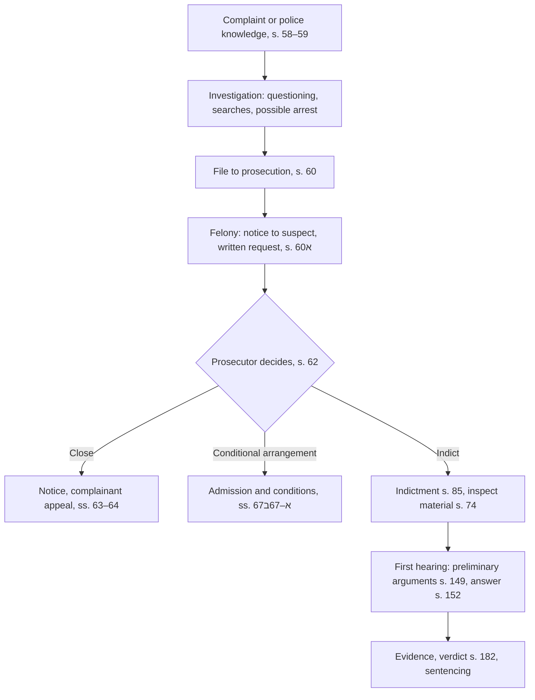

# 08.4 · Criminal procedure in brief: investigation, indictment, trial

This lesson gives you the map of a criminal case in Israel, from the first complaint to the verdict, and the rights a suspect and a defendant have at each stage. Module 5 taught you the victim's side (lessons [05.7](../module-05/lesson-07.md) and [05.8](../module-05/lesson-08.md)); here you see the whole procedure, so that you understand what the police and prosecution are doing and where a suspect can act. Full criminal procedure is a year-3 course.

## Why it matters

> [!WARNING]
> This lesson is about criminal proceedings. If you are a suspect or have been summoned for questioning, do not use this lesson as a substitute for a lawyer: what you say can be used as evidence. Ask for a lawyer before questioning, and ask about the Public Defender if you cannot pay.

Criminal procedure is where the State's power meets the individual most directly. It balances two goals the Supreme Court repeats often: finding the truth and convicting the guilty, and protecting the suspect's dignity, liberty and right to a fair trial. Since Basic Law: Human Dignity and Liberty (1992), that balance is constitutional, and the courts have used it to build doctrines such as the exclusion of unlawfully obtained evidence (Yissacharov) and the defence of "protection from injustice", now codified in s. 149(10).

For a learner the practical value is knowing the stages: when a complaint becomes an investigation, when the file moves to a prosecutor, when you as a suspect may write to ask not to be indicted, what an indictment must contain, and what happens at the first hearing. Most people who meet the criminal system are complainants, witnesses, or suspects in minor matters. Each of these roles has rights you can use yourself.

## Key terms

| עברית | Transliteration | English |
|---|---|---|
| חשוד | chashud | suspect |
| נאשם | ne'esham | defendant (accused) |
| חקירה | chakira | investigation; questioning |
| כתב אישום | ktav ishum | indictment |
| שימוע (לפני הגשת כתב אישום) | shimu'a | pre-indictment hearing (s. 60א) |
| חומר חקירה | chomer chakira | investigation material |
| סניגור ציבורי | sanegor tziburi | Public Defender |
| טענות מקדמיות | ta'anot mukdamot | preliminary arguments |
| הגנה מן הצדק | hagana min hatzedek | protection from injustice (abuse of process) |
| הסדר מותנה | hesder mutne | conditional arrangement (closing a file on conditions) |

## The law

### Investigation: s. 59

> נודע למשטרה על ביצוע עבירה, אם על פי תלונה ואם בכל דרך אחרת, תפתח בחקירה; אולם בעבירה שאינה פשע רשאי קצין משטרה… להורות שלא לחקור…

*Gist:* When the police learn of an offence they must investigate; for offences that are not felonies a senior officer may decide not to investigate if the circumstances do not justify it or another authority is competent. ([CPL s. 59](https://he.wikisource.org/wiki/חוק_סדר_הדין_הפלילי#סעיף_59)) Lesson 05.7 covers the complaint (s. 58).

### Arrest and the 24-hour rule

> מי שנעצר בידי הקצין הממונה… יובא בהקדם האפשרי, ולא יאוחר מ־24 שעות, בפני שופט.

*Gist:* A person arrested by the officer in charge must be brought before a judge as soon as possible and within 24 hours, with special rules around Shabbat and holidays. ([Arrests Law s. 29](https://he.wikisource.org/wiki/חוק_סדר_הדין_הפלילי_(סמכויות_אכיפה_–_מעצרים)#סעיף_29)) On arrest the officer must explain the reason and the right to have a relative and a lawyer notified and to meet a lawyer (s. 32); a detainee is entitled to meet and consult a lawyer, in private, without delay, subject to limited, reasoned postponements (s. 34). Periods: [current numbers](../../references/current-numbers.md).

### Transfer to the prosecution and the pre-indictment hearing: s. 60א

> (ד) חשוד רשאי, בתוך 30 ימים מיום קבלת ההודעה, לפנות בכתב לרשות התביעה…, בבקשה מנומקת, להימנע מהגשת כתב אישום, או מהגשת כתב אישום בעבירה פלונית…

*Gist:* When the investigation material in a felony case reaches the prosecution, the suspect is notified, and may within the set period ask in writing, with reasons, that no indictment be filed or that a lighter charge be chosen; the prosecution may invite him to present his case. ([CPL s. 60א](https://he.wikisource.org/wiki/חוק_סדר_הדין_הפלילי#סעיף_60א); period in [current numbers](../../references/current-numbers.md)) The notice does not apply to someone indicted while in custody (s. 60א(ז)).

### The decision to indict: s. 62

A prosecutor who finds the evidence sufficient "shall indict", unless "the circumstances of the case as a whole" do not suit prosecution; a decision not to prosecute on that ground needs a senior prosecutor's approval (s. 62(א)). The suspect is told in writing; the complainant may appeal (ss. 63–64; lesson 05.8). Instead of indicting, the prosecutor may close the file under a **conditional arrangement** (הסדר מותנה): the suspect admits the facts and meets conditions such as a payment or treatment, where the fitting sentence would not include actual imprisonment (ss. 67א–67ב). ([CPL ss. 62, 67א–67ב](https://he.wikisource.org/wiki/חוק_סדר_הדין_הפלילי#סעיף_62))

### The indictment: s. 85

> כתב אישום יכיל – (1) שם בית המשפט…; (2) ציון מדינת ישראל כמאשים או שם הקובל ומענו; (3) שם הנאשם ומענו; (4) תיאור העובדות המהוות את העבירה…; (5) ציון הוראות החיקוק…; (6) שמות עדי התביעה.

*Gist:* An indictment names the court, the prosecutor (the State, or the private complainant), the defendant, the facts with place and time, the provisions charged and the prosecution witnesses. ([CPL s. 85](https://he.wikisource.org/wiki/חוק_סדר_הדין_הפלילי#סעיף_85))

### Inspection of investigation material: s. 74

After an indictment for a felony or misdemeanour, the defendant and his lawyer may inspect the investigation material and the list of everything collected, at any reasonable time; a dispute over whether something is "investigation material" goes to a judge (s. 74(א)–(ד)). ([CPL s. 74](https://he.wikisource.org/wiki/חוק_סדר_הדין_הפלילי#סעיף_74))

### Preliminary arguments and the answer to the charge: ss. 149, 152

At the start of the trial the defendant may raise preliminary arguments: lack of territorial or subject-matter jurisdiction, a defect in the indictment, facts that are not an offence, previous acquittal or conviction, another pending trial, immunity, limitation, pardon, and

> (10) הגשת כתב האישום או ניהול ההליך הפלילי עומדים בסתירה מהותית לעקרונות של צדק והגינות משפטית.

*Gist:* filing the indictment or conducting the proceedings substantially contradicts principles of justice and legal fairness. ([CPL s. 149](https://he.wikisource.org/wiki/חוק_סדר_הדין_הפלילי#סעיף_149)) Then the court asks the defendant for his answer to the charge; he may stay silent, admit or deny facts, and add facts; silence may strengthen the prosecution's evidence, and an alibi must be raised at once (s. 152).

### Appointment of a defender: s. 15

The court appoints a defender for a defendant without one in listed cases: murder or offences punishable by death or life imprisonment, or ten years or more in the district court; minors under 16 outside the juvenile court; a defendant who is mute, blind, deaf or may be mentally ill or impaired; offences with mandatory actual imprisonment; and where the prosecutor gave notice that it may seek actual imprisonment (s. 15(א)). The Public Defender Law adds eligibility by means (lesson [01.6](../module-01/lesson-06.md)). ([CPL s. 15](https://he.wikisource.org/wiki/חוק_סדר_הדין_הפלילי#סעיף_15))

## Leading cases

### ע״פ 5121/98 יששכרוב נ׳ התובע הצבאי הראשי (4.5.2006)

Recap from lesson 01.6. A soldier's confession was obtained without telling him of his right to consult a lawyer. The Supreme Court adopted a doctrine of judicial exclusion: evidence obtained unlawfully may be excluded where admitting it would substantially infringe the right to a fair trial, weighing the nature of the illegality, its effect on the evidence and the social cost of exclusion. Since 2022 the doctrine is codified in Evidence Ordinance s. 56א (lesson [23.5](../module-23/lesson-05.md)). Why it matters: the rights in Arrests Law ss. 32–34 have teeth; a violation can cost the prosecution its key evidence. [English translation](https://larc.cardozo.yu.edu/iscp-opinions/411)

### בג״ץ 9264/04 מדינת ישראל נ׳ בית משפט השלום בירושלים (6.6.2005)

In an indecent-act prosecution, defence counsel asked under s. 74 to inspect the complainant's whole personal diary, of which only parts were in the file; the magistrates' court ordered it produced after hearing only the defence. The High Court of Justice held that the court's power under s. 74(ד) is broad: it is not removed because the material is not in the prosecution's hands or because a document order under s. 108 is also available. The test is relevance and a real (not speculative) chance that the material will help the defence; parts of a diary about the charge or the accused will tend to be investigation material, other parts will not, and the court must balance the complainant's privacy against a fair trial. Because the order was made without hearing the State on the complainant's privacy, the petition was granted in part. Why it matters: the right to the investigation material is wide but not unlimited, and privacy arguments must be heard before such an order. [English translation](https://larc.cardozo.yu.edu/iscp-opinions/364)

### בג״ץ 11339/05 מדינת ישראל נ׳ בית המשפט המחוזי בבאר שבע (8.10.2006)

The Court reconsidered the 1976 Kinsey rule, which barred calling an accomplice whose own separate trial had not ended to testify against a defendant. All justices agreed the rule should generally no longer apply; they differed on how sweepingly to reject it, and stressed caution in weighing such testimony. Why it matters: it shows how criminal procedure rules made by judges can be revisited as conditions change, balancing efficient trials against fairness. [English translation](https://larc.cardozo.yu.edu/iscp-opinions/361)

## How it works in practice

### The stages at a glance

### Who prosecutes

The State Attorney's Office (district attorneys) prosecutes most felonies; police prosecutors handle most misdemeanours and some felonies; other authorities prosecute their own offences (tax, environment, municipal bylaws). A private person may prosecute some offences by private complaint (lesson 05.8).

### The suspect's practical rights

- **Before questioning:** ask whether you are a suspect or a witness, and ask to consult a lawyer. Questioning under caution includes the warning that you need not say anything that may incriminate you and that what you say may be used as evidence.
- **On arrest:** the reason, notice to a relative and a lawyer, a lawyer meeting, and a judge within 24 hours (Arrests Law ss. 29, 32, 34).
- **When the file reaches the prosecutor (felony):** a letter giving you the address to write to; use the period to send a reasoned request (s. 60א).
- **After indictment:** inspect the material (s. 74), apply for a defender if eligible (s. 15; Public Defender), raise preliminary arguments at the start (s. 149).

### Criminal records and timing

Closing a file, a conditional arrangement and a conviction have different effects on police and criminal records; year-3 module 24 covers them. Prosecution limitation periods are in lesson [05.1](../module-05/lesson-01.md) and [current numbers](../../references/current-numbers.md).

## Worked example

Dvir Shalom, a 24-year-old student from a moshav near Ashkelon, was questioned after a fight outside a bar; another man was lightly injured. Dvir says he was pushed first. Four months later he receives a letter from the district attorney's office: the investigation material in a felony file (aggravated assault) has been transferred to it, and he may write within the period set in the law.

1. **What the letter is.** A notice under s. 60א(א). It is not an indictment; it is his chance to be heard before one.
2. **Lawyer or not?** A felony with possible prison: he contacts the Public Defender's office and a private lawyer for a consultation. The Public Defender explains that at this stage representation depends on eligibility; he decides to pay for a lawyer to write the request.
3. **What the request says.** Reasons not to indict or to charge a lesser offence: the CCTV shows the other man pushing first (self-defence, lesson [05.4](../module-05/lesson-04.md)); the injury was light; Dvir has no record. It asks, alternatively, for a conditional arrangement (s. 67א).
4. **Outcome options.** The prosecutor may close the file, offer a conditional arrangement, indict for a lesser charge, or indict as planned. If indicted, his lawyer will inspect the material (s. 74) and consider preliminary arguments (s. 149).

Dvir did not act without a lawyer; what he did himself was recognise the stage, diary the period and get help in time.

## Do it yourself

### You need

- The text of CPL ss. 59–64, 60א, 74, 85, 149 and 152 ([Wikisource](https://he.wikisource.org/wiki/חוק_סדר_הדין_הפלילי)).
- The supplied case: Dvir Shalom above, or a published indictment you find in a news report (no personal data of private people in your notes).
- 40 minutes.

### Steps

1. **Map the stages (10 min).** Copy the flowchart and write, at each box, who decides, the section, and any deadline from [current numbers](../../references/current-numbers.md).
2. **Rights table (10 min).** For each stage write one right of the suspect or defendant and its source (Arrests Law ss. 29, 32, 34; CPL ss. 60א, 74, 15, 149, 152).
3. **Read an indictment (10 min).** Check a sample indictment against s. 85: are all six items there? Which facts would the defence attack?
4. **Outline a s. 60א request (10 min).** For Dvir, write five headings a lawyer would use: factual dispute, legal defence, harm and circumstances, personal circumstances, the alternative requested.

### Template

None. A request under s. 60א should be written by a lawyer; the outline is for understanding only.

### How you know it worked

- Your map shows where the suspect can act before an indictment.
- Your rights table cites a section for every right.
- You can say which of the s. 149 arguments could apply to a given indictment.

### Self-check

- [ ] I know the police must investigate felonies (s. 59).
- [ ] I know what a s. 60א letter is and that the period for answering is short.
- [ ] I know the defendant may inspect the investigation material after indictment (s. 74).
- [ ] I know when the court must appoint a defender (s. 15).

## Without a lawyer

### Can you do this yourself?

Partly. A defendant may conduct his own defence; the court must appoint a defender in the cases in s. 15, and the Public Defender represents eligible people. As a complainant you can file a complaint, assert victims' rights and appeal a closure yourself (module 5). As a suspect, act alone only in minor matters such as some traffic or municipal offences; even then, a consultation is wise.

### Where and how

- Police station (complaint, questioning); the prosecution address in a s. 60א letter; the magistrates' or district court criminal registry.
- Public Defender: ask the judge at the first hearing, or contact the district office (see [where to get help](../../references/where-to-get-help.md)).
- Periods for s. 60א and arrest: [current numbers](../../references/current-numbers.md); forum rules: [can I act without a lawyer](../../references/can-i-act-without-a-lawyer.md).

### Stop and get a lawyer when

- You are summoned for questioning as a suspect, or arrested.
- You receive a s. 60א notice or an indictment for a felony.
- The prosecution offers a plea bargain or a conditional arrangement: the consequences for your record need advice.
- You are a complainant in a sexual or violent offence: free Legal Aid may be available (lesson 05.7).

## What goes wrong

| Mistake | Consequence | How to fix | How to avoid |
|---|---|---|---|
| Talking at length to "clear things up" without a lawyer | Statements used as evidence | Consult a lawyer before any further questioning | Ask for a lawyer first; you may remain silent |
| Ignoring a s. 60א letter | Chance to avoid indictment lost | Write late with reasons; the prosecutor may still consider it | Diary the period the day the letter arrives |
| Raising an alibi only at trial | Needs the court's leave (s. 152(ד)) | Ask leave with reasons | Raise it in the answer to the charge |
| Raising preliminary arguments late | Some may be raised later only with leave (s. 151) | Raise them as soon as possible | Check s. 149 at the first hearing |
| Assuming a closed file erases everything | Surprises in records checks | Check records rules (year 3) | Ask how the file was closed and on what ground |

## Review

- Police must investigate felonies; the file then goes to a prosecutor, who indicts, closes, or offers a conditional arrangement (ss. 59–62, 67א).
- Before a felony indictment the suspect is notified and may ask in writing not to be indicted (s. 60א).
- Arrested persons see a judge within 24 hours and may consult a lawyer (Arrests Law ss. 29, 32, 34).
- After indictment: inspect the material (s. 74), raise preliminary arguments (s. 149), answer the charge (s. 152).
- Courts protect fairness through exclusion of evidence (Yissacharov) and protection from injustice (s. 149(10)).

### Learn more

- Cardozo Israeli Supreme Court Project, Yissacharov (CrimA 5121/98), English: <https://larc.cardozo.yu.edu/iscp-opinions/411>. FREE-FULL, 60 minutes. Fallback: search "Yissacharov" at <https://larc.cardozo.yu.edu/iscp-opinions/>.
