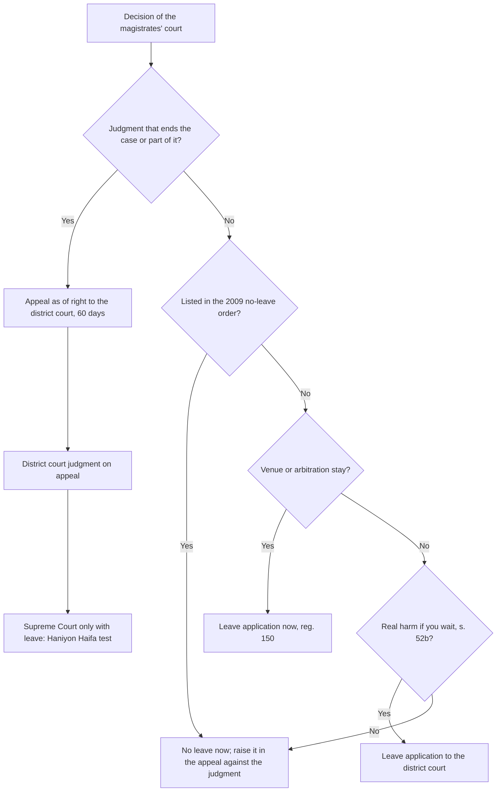

# 15.8 · Judgment, costs and appeals: appeal as of right and leave to appeal

A civil case ends with a judgment and a costs order, and for many parties it then begins again on appeal. This lesson covers what a judgment must contain and when it is due, how costs are decided, and the appeal system under the Courts Law and chapter 18 of the Regulations: which decisions can be appealed and how, the deadlines, fees and security, the powers of the appeal court, the narrow gate to the Supreme Court in a third instance, and stays of execution. The appeal from a small-claims judgment was taught in lesson 12.7; here you learn the general system it belongs to. This is core Bar-exam material.

## Why it matters

The most common appellate mistake is not a bad argument but a wrong route: an appeal filed where only leave was available, a leave application against a decision the law shields from leave, or an appeal filed on day 61. The second is to expect the appeal court to re-try the facts. Appeal courts in Israel rarely interfere with findings of fact and credibility, and the Supreme Court almost never hears a third round. Knowing the routes and limits lets you decide quickly whether an appeal is worth its fee, its security and its risk of costs.

Behind the rules is a policy of **finality and economy**. Every case is entitled to one full review; a second review is a privilege for issues of general importance. Interim decisions are generally reviewed only at the end, unless waiting would cause real harm (Courts Law s. 52(ב)). The trade-off is that a wrong interim decision may have to be lived with until judgment.

## Key terms

| עברית | Transliteration | English |
|---|---|---|
| פסק דין | psak din | judgment (final decision) |
| החלטה אחרת (החלטת ביניים) | hachlata acheret (hachlatat beinayim) | other (interlocutory) decision |
| ערעור בזכות | ir'ur bizchut | appeal as of right |
| בקשת רשות ערעור (בר״ע / רע״א) | bakashat reshut ir'ur | application for leave to appeal |
| גלגול שלישי | gilgul shlishi | third instance |
| ערעור שכנגד | ir'ur shekeneged | cross-appeal |
| ערובה להוצאות המשיב | arevuta lehotza'ot hameshiv | security for the respondent's costs |
| עיכוב ביצוע | ikuv bitzu'a | stay of execution |
| דיון נוסף | diyun nosaf | further hearing (Supreme Court, expanded panel) |
| פסיקתה | psikta | formal order embodying the judgment |

## The law

### The judgment: reg. 129, reg. 133

A decision is given as soon as possible after the hearing; it contains a short account of the disputes, the findings of fact, the legal questions, the decision and brief reasons, with detailed reasons where it breaks new ground (reg. 129(א)–(ב)). At first instance, a judge who has not decided within 90 days of the end of the hearing must report in writing to the court's president (reg. 129(ג)). On request the court may sign a **psikta**, a formal order stating the parties, the relief and the costs, useful for enforcement abroad or at the Land Registry (reg. 133).

### Costs: regs 151–156

> (א) חיוב בעל דין בתשלום הוצאות נועד לשפות את בעל הדין שכנגד על הוצאותיו בהליך בהתחשב בתוצאותיו, במשאבים שנדרשו לניהולו ובהתנהלות בעלי הדין.

*Gist:* Costs compensate the other side for its expenses, in light of the outcome, the resources the case required and the parties' conduct; they must balance access to court, property and equality between the parties. ([reg. 151](https://he.wikisource.org/wiki/תקנות_סדר_הדין_האזרחי))

At the end of the case the court awards reasonable and fair costs unless there are special reasons not to (reg. 152). Lawyer's fees awarded to the winner are not below the Bar's minimum recommended tariff unless special reasons apply; VAT is added where the winner pays it; and the court weighs the relief given against the sum claimed, the conduct of the case, its complexity and the costs asked, and gives reasons (reg. 153). Out-of-pocket expenses are awarded only if itemised in the summations with documents (reg. 155). A party who prolonged the case needlessly may pay costs regardless of the result, to the other side or to the Treasury (reg. 156), and abuse of process can lead to costs against the party and, in special cases, its lawyer (reg. 151(ג)).

### Routes of appeal: Courts Law ss. 52 and 41

> (א) פסק דין של בית משפט שלום ניתן לערעור לפני בית משפט מחוזי.
> (ב) החלטה אחרת של בית משפט שלום בענין אזרחי ניתנת לערעור לפני בית משפט מחוזי, אם ניתנה רשות לכך מאת שופט של בית המשפט המחוזי. רשות כאמור… תינתן אם שוכנע בית המשפט כי אם הערעור על ההחלטה יידון במסגרת הערעור על פסק הדין ולא באופן מיידי, יהיה בכך כדי להשפיע באופן ממשי על זכויות הצדדים או שעלול להיגרם לצד להליך נזק של ממש, או שעלול להתנהל הליך מיותר או בדרך שגויה.

*Gist:* A magistrates' court judgment is appealable as of right to the district court; any other decision only with leave, given only where waiting for the final appeal would substantially affect the parties' rights, cause real harm, or lead to an unnecessary or misdirected proceeding. ([Courts Law s. 52](https://he.wikisource.org/wiki/חוק_בתי_המשפט))

The same structure applies one level up: a district court judgment at first instance goes to the Supreme Court as of right; a district court's other decision, and its judgment **on appeal**, only with leave of the Supreme Court (s. 41(א)–(ב)). A small-claims judgment goes to the district court only with leave, before a single judge (s. 64; lesson [12.7](../module-12/lesson-07.md)).

### Decisions with no leave at all: the 2009 order

Under s. 52(ג)(1) and s. 41(ג)(1) the Minister of Justice has listed decisions on which leave is never given, for example: setting or changing dates; extending a statutory period (unless refusal blocks opening the proceeding); the length of pleadings; the stages of the case (save splitting the trial or a separate hearing of a counterclaim or third-party notice); summoning and questioning witnesses (save refusing to summon a witness or admit evidence); **granting** a set-aside request; costs (unless given after the judgment); and granting leave to defend in execution-office claims ([no-leave order, s. 1](https://he.wikisource.org/wiki/צו_בתי_המשפט_(סוגי_החלטות_שלא_תינתן_בהן_רשות_ערעור))). These can still be challenged in the appeal against the final judgment (s. 2 of the order; reg. 150). A decision on venue, and a decision on a stay for arbitration (Arbitration Law ss. 5–6), must be challenged by an application for leave now (reg. 150).

### Form, fee and security: regs 134–135

The appeal (or leave application) has a heading, with the details of the decision appealed, the date it was served, the competent panel and the enabling section, the fee item and the security item, and a body: the relief given or refused, the main points of the decision, and the grounds of appeal with authorities. The body is limited to a few pages, depending on the court (reg. 134(א)). Attach only the decision and documents that were properly before the lower court (reg. 134(ב)). On filing, the appellant deposits security for the respondent's costs in the amount in the Third Schedule and notifies the respondent; the court may exempt or vary it, and may strike out the appeal if security is not given (reg. 135). Fees and security: [current numbers](../../references/current-numbers.md).

### Deadlines: reg. 137

> (א) המועד להגשת ערעור על החלטה הוא שישים ימים מיום שהומצאה.

*Gist:* An appeal is filed within 60 days of service of the decision. ([reg. 137(א)](https://he.wikisource.org/wiki/תקנות_סדר_הדין_האזרחי))

A respondent may cross-appeal within 60 days of being served with the appeal, the security notice or the exemption, whichever is latest (reg. 137(ב)); this does not apply to leave applications (reg. 149(5)). After a set-aside request under reg. 131, time runs from service of the decision on that request (reg. 137(ג)). Recess days are not counted (reg. 179(ב)). Leave applications in small claims have their own period (lesson 12.7).

### Leave applications: reg. 149

The application opens with the reasons for granting leave, within the page limit (reg. 149(1)). The court may grant leave generally or on a point, may **decide the application as if leave were granted and the appeal filed** (the common route), or refer it to a panel of three (reg. 149(2)). A leave application filed where an appeal lay as of right may be heard as an appeal, and vice versa (reg. 149(4)). In a third instance the Supreme Court may dismiss with a one-line decision if the case raises no point of principle beyond the parties and no miscarriage of justice (reg. 148א).

### Powers of the appeal court: regs 138, 144, 146

The appeal court may dismiss without asking for a response if the appeal has no prospect, order a written response, hold a preliminary hearing, decide on the papers, or hear oral argument (reg. 138(א)). An absent appellant has the appeal struck out; an absent respondent leaves the appellant to argue alone (reg. 138(ג)). New evidence is not admitted unless it could affect the result and either could not have been found with reasonable diligence or is needed to prevent a miscarriage of justice (reg. 144). The court may give any decision the lower court should have given, uphold it on other grounds, set it aside and order a new trial, return it for completion, and use these powers for respondents who did not appeal (reg. 146).

### Stay of execution: reg. 145

> (א) הגשת ערעור לא תעכב את ביצוע ההחלטה שעליה מערערים.

*Gist:* Filing an appeal does not stay execution; ask the court that gave the decision (before an appeal is filed) or the appeal court (after), on conditions, with an undertaking and security as for interim relief. ([reg. 145](https://he.wikisource.org/wiki/תקנות_סדר_הדין_האזרחי))

### Further hearing: Courts Law s. 30

A judgment of a three-judge Supreme Court panel may be reheard by five or more judges, on the panel's own decision or on request, if it contradicts an earlier Supreme Court ruling or its importance, difficulty or novelty justifies it (s. 30). It is rare.

## Leading cases

### ר״ע 103/82 חניון חיפה בע״מ נ׳ מצת אור (הדר חיפה) בע״מ, פ״ד לו(3) 123

The leading case on the third instance. A landlord's eviction claim was dismissed in the magistrates' court and on appeal in the district court; it sought leave from the Supreme Court. Shamgar J. (then Deputy President) held that the legislature's basic conception is two instances, and that leave in a third instance is given only where the case raises a question of legal or public importance beyond the parties' private interest: constitutional questions, conflicting lower-court rulings, broad legal questions, or matters of public importance.

**Why it matters:** it is one of the most-cited Israeli decisions, and reg. 148א now writes its test into the Regulations. Exceptions are rare: leave was granted, for example, in the Kafka manuscripts case (בע״מ 6251/15) for public importance, and in the 2025 SLAPP case (רע״א 1954/24; lesson 15.2) to set a rule. Free summary: [Hebrew Wikipedia](https://he.wikipedia.org/wiki/פסק_דין_חניון_חיפה_בע%22מ_נגד_מצת_אור_(הדר_חיפה)_בע%22מ) (⚠️ secondary source; full text not opened).

### ע״א 1530/02 מנורה חברה לביטוח בע״מ נ׳ יובלים אגודה שיתופית

The Supreme Court restated the rule of non-intervention: an appeal court interferes with findings of fact and credibility only in a narrow range of cases, such as an obvious error or a failure to address material evidence. Free summary: [Hebrew Wikipedia, ערעור](https://he.wikipedia.org/wiki/ערעור) (⚠️ secondary source; full text not opened).

**Why it matters:** an appeal that only re-argues which witness to believe will almost always fail. Build your appeal on errors of law, on misreading of documents, or on evidence the judge ignored.

### בנק לאומי לישראל בע״מ נ׳ Tal Trading Corp. (דנ״א 8447/15, 11.9.2017)

A further hearing (s. 30) of a three-judge Supreme Court ruling that had overruled a long-standing precedent in the law of bills of exchange. The case illustrates the final rung of the ladder: a further hearing is reserved for rulings that change or conflict with established law. English translation: [Versa / LARC](https://larc.cardozo.yu.edu/iscp-opinions/75/).

## How it works in practice

### The appeal decision tree

### Before you appeal: the five questions

1. **Route:** appeal or leave? (s. 52, the order, reg. 150)
2. **Date:** 60 days from service, recess excluded, or from the set-aside decision.
3. **Ground:** an error of law, a misread document, ignored evidence. Not "the judge believed the wrong witness".
4. **Money:** fee, security, and the risk of costs if you lose ([current numbers](../../references/current-numbers.md)).
5. **Stay:** do you need execution stayed? Ask the lower court first, with an undertaking and security (reg. 145).

### Responding to an appeal

Diary the 60-day cross-appeal period from the latest of the three triggers (reg. 137(ב)). If the court asks for a written response, it is due within a set period and limited in pages (reg. 140). If it does not ask, you need not respond; the court may dismiss without your response (reg. 138(א)(1)).

## Worked example

Yehudit Saban, a retired teacher from Be'er Sheva, won ₪35,000 in the magistrates' court against an insurer that refused her water-damage claim; the court awarded her ₪3,000 costs. The insurer appeals; she thinks the costs were too low and that she should also have received ₪8,000 for mould damage the court rejected.

1. **The insurer's appeal.** A judgment, so as of right to the district court (s. 52(א)), within 60 days of service. The insurer deposits security and notifies her (reg. 135).
2. **Her cross-appeal.** She counts 60 days from the latest of: service of the appeal, of the security notice (reg. 137(ב)). She cross-appeals on the mould damage: the judge did not address her expert's photos, a ground of "ignored material evidence" (*Menora*). On costs alone she would have weak prospects, but she may include them in the cross-appeal against the judgment.
3. **Stay.** The insurer asks the magistrates' court to stay payment. The court orders the insurer to pay her ₪20,000 now and deposit the rest in court until the appeal (reg. 145), balancing her need against the risk she could not repay.
4. **Hearing.** The district court decides on the papers and a short oral hearing (reg. 138). It dismisses the insurer's appeal: the findings on cause of the leak rested on credibility. It accepts the cross-appeal in part, awarding ₪5,000 for mould, and raises costs.
5. **Third instance?** The insurer considers leave to the Supreme Court. Its lawyer advises that a dispute over one policy's application raises no point beyond the parties (*Haniyon Haifa*; reg. 148א). It pays.

## Do it yourself

### You need

- A judgment or decision you received, or the Yehudit case.
- Courts Law ss. 41, 52, the 2009 order, regs 134–150 open; the [appeal outline template](../../templates/appeal-outline.md).
- About 50 minutes.

### Steps

1. **Classify (10 min).** For five decisions (a refusal to extend time to file a defence; an order to answer an interrogatory; a final judgment; a costs order in an interim decision; a refusal of a temporary injunction), write: appeal, leave, or not now, with the source.
2. **Dates and money (10 min).** For the final judgment, compute the last day to appeal and the fee and security from [current numbers](../../references/current-numbers.md).
3. **Grounds (15 min).** On the appeal outline template, write three grounds of appeal for a judgment of your own or the Yehudit case; label each as law, misread document or ignored evidence.
4. **Stay (10 min).** Write the paragraph of a stay request: prospects of the appeal and the balance of harm.
5. **Costs (5 min).** If you won, list your expenses with documents for the summations (reg. 155).

### Template

- [Appeal outline (מתווה ערעור)](../../templates/appeal-outline.md)

### How you know it worked

- Each classification cites s. 52, s. 41, the order or reg. 150.
- Your deadline accounts for service date and recess.
- Your grounds avoid pure re-argument of credibility.
- Your stay paragraph addresses both prospects and balance.

### Self-check

- [ ] I can tell a judgment from an other decision for appeal purposes.
- [ ] I know which decisions the 2009 order shields from leave.
- [ ] I know when a cross-appeal may be filed.
- [ ] I know the Haniyon Haifa test for a third instance.

## Without a lawyer

> [!IMPORTANT]
> Act in your own name only. This is not legal advice — check current rules before filing.

### Can you do this yourself?

Yes. An individual may appeal or seek leave personally (reg. 170). Online appeal filing on Net HaMishpat is designed for lawyers; unrepresented parties can file at the registry of the appeal court (see [can I act without a lawyer](../../references/can-i-act-without-a-lawyer.md); ⚠️ manual check of the Judiciary's service page). Appeals are argued on law and the record, which makes them harder than a first-instance case; an hour with a lawyer to test the grounds is often worth it.

### Where and how

- Appeal from a magistrates' court: district court of the same district; from a district court at first instance: Supreme Court.
- Fees, security amounts and exemptions (including the reduced security for Legal Aid clients): [current numbers](../../references/current-numbers.md).
- Free help: Legal Aid where eligible; the Judiciary's appeal service page (⚠️ manual check); [where to get help](../../references/where-to-get-help.md).

### Stop and get a lawyer when

- The appeal is to the Supreme Court, or you seek leave in a third instance.
- The appeal raises a point of law you cannot find authority for.
- The other side seeks a stay with large sums at stake.
- You missed the deadline and need an extension.

## What goes wrong

| Mistake | Consequence | How to fix | How to avoid |
|---|---|---|---|
| Appeal against an interim decision filed as of right | Treated as a leave application or struck out (regs 147, 149(4)) | Ask the court to hear it as a leave application | Check s. 52(ב) first |
| Leave sought on a decision in the no-leave order | Dismissed; costs | Raise it in the appeal against the judgment | Check the order's list |
| Counting 60 days from the judgment date, not service | Late; struck out (reg. 147(ב)(1)) | Ask to extend, with special reasons | Diary from service, excluding recess |
| Re-arguing credibility | Dismissed; costs | Reframe on law or ignored evidence if possible | Build grounds on reviewable errors |
| Assuming the appeal stops enforcement | Execution proceeds (reg. 145(א)) | Ask for a stay with security | Ask the lower court for a stay at once |

## Review

- Costs follow the outcome, resources and conduct, with at least the minimum tariff for a lawyer's fee unless special reasons (regs 151–153).
- Judgments are appealable as of right; other decisions only with leave where waiting would cause real harm; some never, by the 2009 order (Courts Law ss. 41, 52).
- Appeal within 60 days of service, with fee and security; cross-appeal within 60 days of the latest trigger (regs 135, 137).
- Appeal courts rarely disturb findings of fact; new evidence only in narrow cases (reg. 144; *Menora*).
- The Supreme Court grants third-instance leave only for issues beyond the parties (*Haniyon Haifa*; reg. 148א); an appeal does not stay execution (reg. 145).

### Learn more

- Versa / LARC, *Bank Leumi le-Israel v. Tal Trading Corp.*, CFH 8447/15, English translation. FREE-FULL, 60 minutes, [larc.cardozo.yu.edu/iscp-opinions/75](https://larc.cardozo.yu.edu/iscp-opinions/75/). Fallback: search "Tal Trading" at [larc.cardozo.yu.edu/iscp-opinions](https://larc.cardozo.yu.edu/iscp-opinions/).
