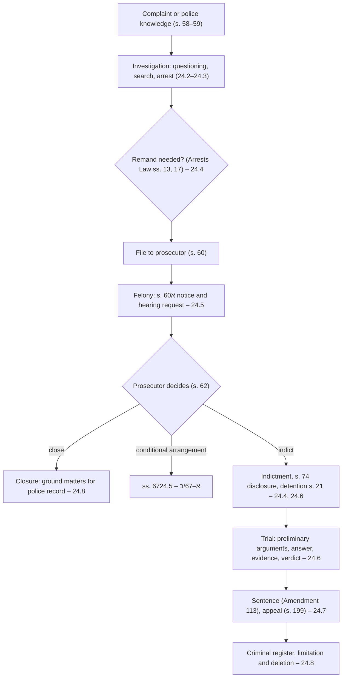

# 24.1 · The structure of the criminal process

This lesson gives you the full map of an Israeli criminal case at the depth of a university course in criminal procedure (TAU דיון פלילי) and of the Bar exam's procedural part: the stages, the people who decide at each one, the constitutional frame that governs them, and the route a case takes according to the offence. Lesson [08.4](../module-08/lesson-04.md) gave you the outline; this module fills in every stage, and by the end of this lesson you will be able to place any letter, summons or decision you receive on that map and know which section applies.

## Why it matters

> [!WARNING]
> This module is about criminal proceedings, police powers and arrest. It teaches lawful self-protection: knowing your rights, asking for a lawyer and the Public Defender, writing to the prosecution, defending yourself only in minor matters, and cleaning up records. It never teaches how to avoid or obstruct an investigation. If you are a suspect, have been summoned for questioning or have been arrested, ask for a lawyer before you say anything; what you say can be used as evidence.

Criminal procedure is the law of how the State may investigate, accuse, try and punish. Substantive criminal law (module 5) tells you what an offence is; procedure decides whether the truth is found fairly, how long a person may be held, and what a defendant may see and say. For most people the procedure matters more than the offence: a closed file that still sits in the police record, a fine paid without thinking, a night in custody, or a plea bargain signed in a corridor shape a life more than the definition of assault.

Procedure is also where constitutional rights are most concrete. Basic Law: Human Dignity and Liberty protects personal liberty (s. 5) and allows it to be limited only by a law that meets the limitation clause (s. 8). Every arrest, search, remand and sentence is a limitation of that right, so every one of them must have a statutory basis and must be proportionate. The Supreme Court has used this frame to reinterpret older procedural law (Ganimat), to exclude unlawfully obtained evidence (Yissacharov), and to give the defence of "protection from injustice" a statutory place (s. 149(10), lesson [24.6](lesson-06.md)).

## Key terms

| עברית | Transliteration | English |
|---|---|---|
| הליך פלילי | halich plili | criminal process |
| רשות חוקרת | rashut chokeret | investigating authority |
| רשות תביעה | rashut tvi'a | prosecuting authority |
| פרקליטות המחוז | praklitut hamachoz | district attorney's office |
| תביעה משטרתית | tvi'a mishtartit | police prosecution |
| פשע / עוון / חטא | pesha / avon / chet | felony / misdemeanour / contravention |
| מעצר עד תום ההליכים | ma'atzar ad tom hahalichim | detention until the end of proceedings |
| הכרעת דין / גזר דין | hachra'at din / gzar din | verdict / sentence |
| זכות לחירות | zchut lecherut | right to liberty |
| הגנה מן הצדק | hagana min hatzedek | protection from injustice (abuse of process) |

## The law

### Liberty as a constitutional right: Basic Law ss. 5 and 8

> אין נוטלים ואין מגבילים את חירותו של אדם במאסר, במעצר, בהסגרה או בכל דרך אחרת.

*Gist:* No one's liberty may be taken or restricted by imprisonment, arrest, extradition or any other way. ([Basic Law: Human Dignity and Liberty s. 5](https://he.wikisource.org/wiki/חוק-יסוד:_כבוד_האדם_וחירותו#סעיף_5))

> אין פוגעים בזכויות שלפי חוק־יסוד זה אלא בחוק ההולם את ערכיה של מדינת ישראל, שנועד לתכלית ראויה, ובמידה שאינה עולה על הנדרש…

*Gist:* These rights may be limited only by a law that befits the State's values, for a proper purpose, and to an extent no greater than required (s. 8). Section 12 bars emergency regulations from changing the Basic Law, except during a declared state of emergency and then only for a proper purpose and no more than required. The proportionality method is in lesson [06.3](../module-06/lesson-03.md).

The Arrests Law repeats the principle in its first section: "אין מעצר ועיכוב אלא בחוק או לפי חוק מכוח הסמכה מפורשת בו", and arrest must preserve human dignity as far as possible ([Arrests Law s. 1](https://he.wikisource.org/wiki/חוק_סדר_הדין_הפלילי_(סמכויות_אכיפה_–_מעצרים)#סעיף_1)). Lesson [24.2](lesson-02.md) takes it from there.

### The accuser and the prosecutors: CPL ss. 11–12

> המאשים במשפט פלילי הוא המדינה והיא תיוצג בידי תובע שינהל את התביעה.

*Gist:* The accuser in a criminal trial is the State, represented by a prosecutor ([CPL s. 11](https://he.wikisource.org/wiki/חוק_סדר_הדין_הפלילי#סעיף_11)). The prosecutors are the Attorney General and his representatives (the State Attorney, district attorneys and other State Attorney's Office lawyers, and anyone the Attorney General authorises), and police officers appointed as prosecutors (s. 12). The private criminal complaint (s. 68) is the exception, covered in lesson [05.8](../module-05/lesson-08.md).

### Who handles the file: CPL s. 60

Material from a felony investigation goes to the district attorney (פרקליט מחוז); material in offences that are not felonies goes to a police prosecutor, with lists of exceptions in the First Schedule A that move some misdemeanours to the State Attorney's Office and some felonies to police lawyers (s. 60(ב)–(ד)). Under s. 60(יא) the police send material to the State Attorney's Office without their own recommendation on indictment, only a written view of the evidence (s. 60(יא)). ([CPL s. 60](https://he.wikisource.org/wiki/חוק_סדר_הדין_הפלילי#סעיף_60))

### Time limits for the investigation and the decision: s. 57א

> משך הליכי חקירה והעמדה לדין יהיה בהתאם לתקופות שייקבעו בנוהלי רשויות החקירה באישור היועץ המשפטי לממשלה ובהנחיות היועץ המשפטי לממשלה…; לא יוגש כתב אישום אם חלפו התקופות… אלא בהסכמת היועץ המשפטי לממשלה.

*Gist:* The length of investigation and the decision to prosecute is governed by periods set in police procedures and Attorney General guidelines; once they pass, an indictment needs the Attorney General's consent. ([CPL s. 57א](https://he.wikisource.org/wiki/חוק_סדר_הדין_הפלילי#סעיף_57א)) This is separate from the limitation periods of s. 9 (lesson [05.1](../module-05/lesson-01.md); [current numbers](../../references/current-numbers.md)).

### Which court: Courts Law s. 51

> בית משפט שלום ידון באלה: (1)(א) עבירות שעונשן קנס בלבד או מאסר לתקופה שאינה עולה על שבע שנים…

*Gist:* The magistrates' court tries offences punishable by a fine only or by up to seven years' imprisonment (with listed exceptions both ways); the district court tries the rest. ([Courts Law s. 51](https://he.wikisource.org/wiki/חוק_בתי_המשפט#סעיף_51)) Juvenile courts, traffic courts (a magistrates' court sitting on traffic cases) and local-affairs courts (municipal bylaws, planning) are specialised magistrates' courts.

## Leading cases

### דנ״פ 2316/95 גנימאת נ׳ מדינת ישראל (1995)

A young man was charged with stealing two cars and held in detention until the end of proceedings because car theft had become a "national plague". The Court, in a further hearing, held that after Basic Law: Human Dignity and Liberty every statute, including those enacted before it, must be interpreted in light of the right to liberty; detention for dangerousness requires concrete evidence of the defendant's personal danger, the burden is on the State, and the general prevalence of an offence is not enough. Why it matters: Ganimat is the bridge between the 1992 constitutional change and criminal procedure; it shaped the Arrests Law of 1996 and the proportionality test in its s. 21(ב)(1) ("less harmful means"). Free source: the [Hebrew Wikipedia article](https://he.wikipedia.org/wiki/עימאד_גנימאת_נ'_מדינת_ישראל) (secondary; the ruling itself is on the Judiciary's site, which blocks automated access).

### ע״פ 5121/98 יששכרוב נ׳ התובע הצבאי הראשי (4.5.2006)

You met the holding in lesson 08.4: evidence obtained unlawfully may be excluded where admitting it would substantially infringe the right to a fair trial. Here read it for its structure. The Court rejected both extremes (automatic exclusion as in the US "fruit of the poisonous tree" rule, and the old Israeli rule that admissibility depends only on reliability) and chose a relative, case-by-case doctrine rooted in the Basic Law, codified in 2022 as Evidence Ordinance s. 56א (lesson [23.5](../module-23/lesson-05.md)). Why it matters: it is the clearest statement that Israeli criminal procedure balances truth-finding against the protection of rights, and that the balance is constitutional. [English translation](https://versa.cardozo.yu.edu/opinions/yissacharov-v-chief-military-prosecutor)

## How it works in practice

### Two models of the process

Criminal-procedure courses often start with the American scholar Herbert Packer's two models. The **crime-control model** values speed and efficiency: most cases end in an admission or a plea, and the police and prosecution filter out the innocent early. The **due-process model** values reliability and limits on power: every stage is a hurdle the State must clear, and errors are corrected by rules that exclude evidence or stop proceedings. No real system is either; Israeli law mixes them. The plea bargain, the conditional arrangement and the fine offence are crime-control tools; the 24-hour rule, the right to inspect the investigation material and protection from injustice are due-process tools. When you read a section, ask which model it serves; it often tells you how a court will interpret it.

### The stages and the decision-makers

| Stage | Who decides | Main source | Where you can act yourself |
|---|---|---|---|
| Opening an investigation | Police (or another investigating authority) | CPL s. 59 | As a complainant (module 5) |
| Questioning, search, detention, arrest | Police officer; officer in charge; a judge for warrants | Arrests Law; Search Ordinance; Interrogation Law | Knowing and asserting rights (24.2–24.3) |
| Remand and bail | Magistrates' judge; appeal to the district court | Arrests Law ss. 13–17, 21, 44–53 | Through a lawyer or Public Defender (24.4) |
| Decision to indict | District attorney or police prosecutor | CPL ss. 60–62, 67א | A written s. 60א request (24.5, 24.9) |
| Trial | Magistrates' or district court | CPL ss. 143–193 | Self-defence only in minor matters (24.6, 24.9) |
| Appeal | District court or Supreme Court | CPL ss. 198–220 | Lawyer strongly advised (24.7) |
| Records | Police (criminal and police registers); the President | Criminal Information Law 2019 | Inspection and deletion requests (24.8, 24.10) |

### Fine offences and administrative offences: the fast lane

Most people's only encounter with criminal procedure is a fine notice: a traffic ticket, a parking fine, a littering or noise fine. These are "fine offences" (עבירות קנס, CPL s. 221) handled by "choice of trial" (ברירת משפט, s. 228): you either pay, which counts as a conviction and a served sentence (s. 229(ח)), or ask to be tried, or ask the prosecutor to cancel the notice. Administrative offences (עבירות מינהליות) under the Administrative Offences Law 1985 are a separate, non-criminal route. Lesson [24.9](lesson-09.md) is a lab on this lane.

### Neutrality note

The balance between effective enforcement and suspects' rights is politically contested in Israel, as everywhere: some argue the courts and rules have made enforcement too slow and lenient; others argue that long remands, plea pressure and records punish people who were never convicted. The course states the law and each side's strongest argument, not a verdict.

## Worked example

Rania Haddad, 38, a pharmacist from Nazareth, gets three envelopes in one month: a parking fine from the municipality, a summons to the Nazareth police station "for questioning under caution" about a road-rage incident, and a letter from a car-rental company saying it passed her details to the police for a speed-camera ticket.

1. **Parking fine.** A fine offence under a municipal bylaw; choice of trial (s. 228). She may pay, ask the municipal prosecutor to cancel it, or ask to be tried at the local-affairs court within the period in s. 229 ([current numbers](../../references/current-numbers.md)). Lesson 24.9.
2. **Summons for questioning under caution.** "Under caution" (באזהרה) means she is a suspect. The road-rage incident may be threats or assault, misdemeanours or felonies depending on the facts. This is the stage where she must not act alone: she calls a lawyer before attending (lesson 24.3), and if she cannot afford one she asks about the Public Defender (lesson 24.3, Public Defender Law s. 19).
3. **Speed-camera ticket.** A traffic fine offence; the owner may prove that someone else drove (CPL s. 229(א)(1); Traffic Ordinance s. 27ב). Here she was not the owner; the notice will come to her as the hirer.
4. **The map.** Two items are in the fast lane, where she can act herself. One is a real criminal investigation, where her task is to recognise the stage and get help.

## Do it yourself

### You need

- The text of CPL ss. 11–12, 57א, 59–62 and 221–230 and Arrests Law s. 1 ([Wikisource](https://he.wikisource.org/wiki/חוק_סדר_הדין_הפלילי)).
- Courts Law s. 51 and Penal Law s. 24 (offence classes; lesson [05.1](../module-05/lesson-01.md)).
- Three real or supplied criminal "events": a fine notice you received, a news report of an indictment, and the Rania Haddad case.
- 40 minutes.

### Steps

1. **Classify (10 min).** For each event, write the offence, its maximum penalty, its class (felony, misdemeanour, contravention) and whether it is a fine offence.
2. **Route (10 min).** For each, name the investigating authority, the prosecuting body (district attorney, police prosecution, municipal prosecutor), and the court (magistrates', district, traffic, local affairs).
3. **Rights at the current stage (10 min).** Write one right the person has now and its section.
4. **Model check (10 min).** For each event pick one rule that applies and say whether it serves crime control or due process, and why.

### Template

None.

### How you know it worked

- Every event has a class, a route and a court, each with a source.
- You can explain why paying a fine is a conviction and asking to be tried is not an admission.
- You can say which stage of Rania's three matters she may handle herself.

### Self-check

- [ ] I know that liberty is protected by Basic Law s. 5 and limited only under s. 8.
- [ ] I know who prosecutes felonies and who prosecutes most misdemeanours (CPL s. 60).
- [ ] I know the magistrates' court tries offences up to seven years (Courts Law s. 51).
- [ ] I can place a letter or summons on the stage map.

## Without a lawyer

### Can you do this yourself?

Partly. A defendant may conduct his own defence (lesson 08.4; [can I act without a lawyer](../../references/can-i-act-without-a-lawyer.md)), but the court must appoint a defender in the cases in CPL s. 15 and may not impose actual imprisonment on an unrepresented defendant (s. 15ב). In practice you can act alone in the fast lane (fine offences, inspecting your own record, asking to delete a police record, writing to the prosecution in a minor matter). For questioning, arrest, remand, felony charges and anything that may lead to prison, get a lawyer or the Public Defender.

### Where and how

- Fines: the prosecuting body named on the notice (police traffic unit, municipality, other authority), by mail or its online service; court: traffic or local-affairs court.
- Public Defender: district offices; request in writing (Public Defender Law s. 21) or ask the judge at the first hearing ([where to get help](../../references/where-to-get-help.md)).
- Deadlines: [current numbers](../../references/current-numbers.md).

### Stop and get a lawyer when

- You are summoned "under caution" (as a suspect), arrested, or asked to give a DNA sample, a phone password or consent to a search.
- You receive a s. 60א letter or an indictment that is not a fine offence.
- The charge carries possible imprisonment, or you have a previous record.
- You are offered a plea bargain or a conditional arrangement.

## What goes wrong

| Mistake | Consequence | How to fix | How to avoid |
|---|---|---|---|
| Treating a summons "under caution" as a chat | Statements become evidence; no lawyer present | Stop, ask for a lawyer, reschedule if possible | Read the summons: "באזהרה" means suspect |
| Paying a fine you dispute "to get it over with" | Counts as conviction and served sentence (s. 229(ח)); traffic points may follow | Usually none after payment | Decide within the period: pay, cancel request, or ask to be tried |
| Ignoring a fine notice | Treated as convicted when the periods pass (s. 229(ח2)); surcharges | Ask the prosecutor for relief from surcharges (s. 229(ו)) | Diary the periods the day it arrives |
| Confusing limitation (s. 9) with s. 57א periods | Wrong argument at the wrong stage | Raise s. 57א with the prosecution; s. 9 as a preliminary argument (s. 149(7)) | Check both, with a lawyer in non-fine matters |
| Assuming a constitutional right needs a constitutional petition | Missed chance to argue it in the criminal court | Raise it in the remand hearing or trial | Courts interpret procedure in light of the Basic Law (Ganimat) |

## Review

- Liberty is a constitutional right (Basic Law s. 5); every arrest, search, remand and sentence must rest on a law and be proportionate (s. 8).
- The State prosecutes through the State Attorney's Office (most felonies) and the police prosecution (most misdemeanours) (CPL ss. 11–12, 60).
- The magistrates' court tries offences up to seven years; the district court tries the rest (Courts Law s. 51).
- Ganimat requires criminal procedure to be read in light of the Basic Law; Yissacharov allows exclusion of unlawfully obtained evidence.
- Fine offences are a fast lane where you can act yourself; investigations and felonies are not.

### Learn more

- Cardozo Israeli Supreme Court Project, Yissacharov, English: <https://versa.cardozo.yu.edu/opinions/yissacharov-v-chief-military-prosecutor>. FREE-FULL, 60 minutes (read the abstract and the part on the exclusion doctrine). Fallback: <https://larc.cardozo.yu.edu/iscp-opinions/411>.
