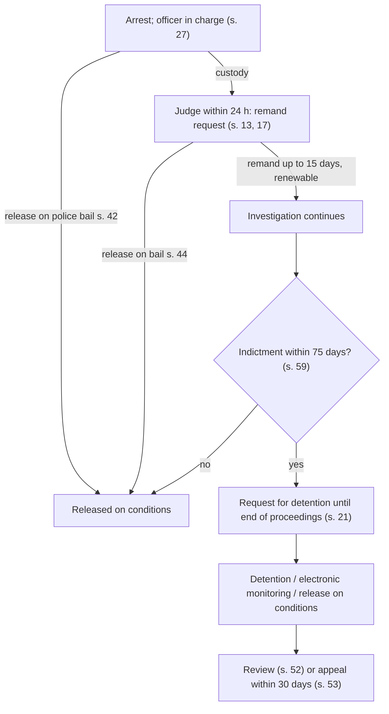

# 24.4 · Remand, release and bail conditions

This lesson follows a person from the 24-hour hearing to the end of the trial: remand to complete the investigation, detention until the end of proceedings, electronic monitoring, release on bail and the conditions that can follow someone for months. You will learn the tests a judge must apply, the time limits that force release, and the routes for changing a condition that is no longer needed, so that you understand the hearing a relative may face and the papers you may be asked to sign as a guarantor.

## Why it matters

> [!WARNING]
> Remand and bail hearings are for a lawyer or the Public Defender, not for self-representation. This lesson helps you understand the process, support a detained family member, act as a guarantor knowingly and ask for a change in your own bail conditions. Breaching a bail condition is grounds for arrest and forfeiture of the bail; obey every condition until a court changes it.

Detention before conviction is the sharpest tension in criminal procedure: the person is presumed innocent, yet loses liberty because of what he might do. The 1996 Arrests Law, written in the shadow of Ganimat, answers with a structure: a judge, short periods, specific grounds, and a duty to prefer the least harmful means. Most people never sit in a cell for long, but many live for months under conditions: house arrest, a ban on leaving the country, a ban on contacting someone, a guarantor who must watch them. Understanding the system helps you avoid two common errors: signing as a guarantor without knowing what you risk, and living with a condition that a simple request could have lifted.

## Key terms

| עברית | Transliteration | English |
|---|---|---|
| מעצר ימים | ma'atzar yamim | remand (pre-indictment custody for investigation) |
| הארכת מעצר | ha'arachat ma'atzar | extension of remand |
| מעצר עד תום ההליכים | ma'atzar ad tom hahalichim | detention until the end of proceedings |
| ראיות לכאורה | ra'ayot lechora | prima facie evidence |
| עילת מעצר | ilat ma'atzar | ground for detention |
| חלופת מעצר | chalufat ma'atzar | alternative to detention |
| שחרור בערובה / בתנאים | shichrur be'arubah / bitna'im | release on bail / on conditions |
| ערב / ערבות צד ג׳ | arev / arvut tzad gimel | guarantor / third-party guarantee |
| מעצר בפיקוח אלקטרוני | ma'atzar befikuach elektroni | electronically monitored detention |
| עיון חוזר / ערר | iyun chozer / arar | request for review / appeal (on detention) |
| תסקיר מעצר | taskir ma'atzar | detention report by a probation officer |

## The law

### Remand before indictment: ss. 13, 17

A judge orders a suspect's arrest only on reasonable suspicion of an offence that is not a contravention, and one ground: (1) a reasonable fear of obstruction of investigation or trial, flight or hiding property, influencing witnesses or harming evidence; (2) a reasonable fear of danger to a person, the public or State security; or (3) investigation steps that can only be taken while the suspect is in custody, for up to five days unless the court is persuaded otherwise (s. 13(א)).

> (ב) שופט לא יצווה על מעצר לפי סעיף קטן (א), אם ניתן להשיג את מטרת המעצר בדרך של קביעת ערובה ותנאי ערובה, שפגיעתם בחירותו של החשוד פחותה.

*Gist:* No remand if bail and conditions can achieve the purpose with less harm to liberty (s. 13(ב)). Periods (s. 17): each remand order up to 15 days, renewable; no more than 30 days in a row for the same event without the Attorney General's approval; and once the investigation is over, release, unless a prosecutor declares an indictment is coming and the court finds a prima facie ground for detention until the end of proceedings, in which case up to five more days (s. 17(ד)). A suspect not indicted within 75 days of arrest is released, with or without bail (s. 59), unless a Supreme Court justice extends it (s. 62). ([Arrests Law ss. 13, 17, 59, 62](https://he.wikisource.org/wiki/חוק_סדר_הדין_הפלילי_(סמכויות_אכיפה_–_מעצרים)#סעיף_13); all periods in [current numbers](../../references/current-numbers.md)) Emergency regulations made in the "Iron Swords" war lengthened some periods for security-offence suspects; check whether they are in force.

### Detention until the end of proceedings: s. 21

After an indictment, the court may order detention until the end of proceedings (including electronically monitored detention) where it finds, on the material before it, a ground: a reasonable fear of obstruction or flight; a reasonable fear of danger; or a charge in a listed category (offences punishable by death or life imprisonment, security offences, drug offences other than use, offences with serious violence, cruelty or weapons, and family violence), which creates a presumption of danger the defendant may rebut (s. 21(א)(1)(ג)). The court may also detain where bail was not provided or was breached (s. 21(א)(2)).

> (ב) בית המשפט לא יתן צו מעצר… אלא אם כן נוכח, לאחר ששמע את הצדדים, שיש ראיות לכאורה להוכחת האשמה, ולענין סעיף קטן (א)(1), לא יצווה… אלא אם כן נתקיימו גם אלה: (1) לא ניתן להשיג את מטרת המעצר בדרך של שחרור בערובה ותנאי שחרור, שפגיעתם בחירותו של הנאשם, פחותה; (2) לנאשם יש סניגור, או שהנאשם הודיע שברצונו שלא להיות מיוצג…

*Gist:* Three conditions: prima facie evidence of guilt, a ground, and no less harmful alternative; and the defendant must have a lawyer (or waive one), failing which the court appoints one (s. 21(ב)–(ג)). The court may postpone the hearing for up to 30 days, keeping the defendant in custody, so the defence can study the material (s. 21(ד)). A probation officer's detention report may be ordered (s. 21א). Electronic monitoring needs the defendant's consent and the court's finding that it achieves the purpose (s. 22ב).

### Time limits after indictment: ss. 60–62

A defendant detained 30 days after indictment whose trial has not begun is released, unless the court postpones by 30 more days at the defendant's request (s. 60). A defendant detained nine months whose trial has not ended in a verdict is released, with or without bail (s. 61), unless a Supreme Court justice extends detention by up to 90 days at a time, or longer in complex cases (s. 62).

### Bail set by the police: ss. 42–43

The officer in charge may release on bail on condition that the suspect appears when required and does not obstruct, and, with the suspect's consent, on conditions with fixed maximum periods: notice of any change of address or work; a ban on leaving the country and depositing the passport; a ban on entering a place; a ban on contacting named people; residence at a place; reporting to a station; house arrest; depositing weapons in violence cases (s. 42(ב)). A suspect who does not agree is brought before a judge (s. 42(ד)). The suspect may appeal to the magistrates' court against the amount or reasonableness of the conditions within a short period, or later if circumstances change (s. 43). ([Arrests Law ss. 42–43](https://he.wikisource.org/wiki/חוק_סדר_הדין_הפלילי_(סמכויות_אכיפה_–_מעצרים)#סעיף_42); periods in [current numbers](../../references/current-numbers.md))

### Bail set by the court: ss. 44–51

The court may release a suspect, defendant or convicted person awaiting appeal on bail or without it (s. 44). It sets the type, amount, conditions and duration "במידה שאינה עולה על הנדרש", considering the offence, the prosecution's information, the record, the person's means and ability to comply (s. 46). Conditions may include those in s. 48(א), among them supervision by a probation officer, drug treatment, a ban on an occupation linked to the offence, and compliance with a protection order; a ban on leaving the country needs a reasonable possibility of non-appearance that a guarantee cannot secure (s. 48(ב)). On a breach, the judge may forfeit the bail and, if a ground exists, detain (s. 51); a guarantor must be heard before his guarantee is forfeited (s. 51(ג)).

### Changing a decision: ss. 52–53

> (א) עצור, משוחרר בערובה או תובע רשאי לפנות לבית המשפט בבקשה לעיון חוזר… אם נתגלו עובדות חדשות, נשתנו נסיבות או עבר זמן ניכר מעת מתן ההחלטה.

*Gist:* A request for review goes to the same court on new facts, changed circumstances or the passage of considerable time; a person held because he cannot provide bail may ask at any time (s. 52). An appeal (ערר) against a court's detention or bail decision goes to the court above, heard by a single judge, within 30 days; from the district court on appeal, only with leave of the Supreme Court (s. 53). ([Arrests Law ss. 52–53](https://he.wikisource.org/wiki/חוק_סדר_הדין_הפלילי_(סמכויות_אכיפה_–_מעצרים)#סעיף_52))

## Leading cases

### דנ״פ 2316/95 גנימאת נ׳ מדינת ישראל (1995)

Lesson [24.1](lesson-01.md) used Ganimat for interpretation; here is its detention doctrine. The majority held that "dangerousness" for detention must be shown from the defendant's own conduct and circumstances, not presumed from the type of offence alone (car theft, however common, did not by itself show that this defendant endangered the public), and that the court must look for alternatives before ordering detention. Why it matters: the Arrests Law codified both points (s. 21(ב)(1)), while listing specific offences in which danger is presumed (s. 21(א)(1)(ג)); a defence lawyer's first questions in any detention hearing come from Ganimat. Free source: [Hebrew Wikipedia](https://he.wikipedia.org/wiki/עימאד_גנימאת_נ'_מדינת_ישראל) (secondary).

### בש״פ 10697/05 אזברגה נ׳ מדינת ישראל (6.12.2005)

A defendant under house arrest asked to leave daily, at fixed times, to pray at the mosque in his town; the district court refused. Justice Rubinstein allowed the appeal in part: weekly prayer at the nearest mosque at once, and daily prayer after three months without incident. Why it matters: bail conditions limit constitutional rights (liberty, religion, work, family) and must be tailored and revisited; a reasoned request for a specific, supervised exception can succeed. [English translation](https://versa.cardozo.yu.edu/opinions/azbarga-v-state-israel)

## How it works in practice

### The hearings, in order

### What happens in a remand hearing

The police representative presents a confidential report to the judge; the suspect and lawyer usually see only the summary of suspicion. The defence argues: no reasonable suspicion; no ground; steps that do not need custody; an alternative (house arrest at a relative's, a guarantor, a ban on contact). Judges often ask "מה החלופה?" — what is the alternative? Families help most by preparing a real one: an address, two guarantors with ID and income, and someone available to supervise.

### Being a guarantor

A guarantor (ערב) signs a guarantee for a sum and, often, undertakes to supervise. If the released person breaches a condition, the court may forfeit the guarantee after hearing the guarantor (s. 51(ג)). Before signing, ask: what exactly am I guaranteeing, for how long, and am I a "supervisor" who must be present at all times? A supervisor who leaves the defendant alone breaches the arrangement.

### Changing your own conditions

Conditions often outlast their purpose. After months without incident, a person under house arrest or a ban on travel may ask for a change: a request for review in the court that set them (s. 52) if circumstances changed or time passed; an appeal within 30 days if the decision was wrong from the start (s. 53); for police-set conditions, an appeal to the magistrates' court (s. 43). A focused request (work hours, a family event, a medical treatment, a flight for a funeral) with documents and the prosecution's position has the best chance. In a simple case you may write it yourself; with a lawyer it is better.

## Worked example

Yosef Mizrahi, 27, a delivery driver from Ashdod, is arrested after a bar fight in which a man was stabbed. He denies holding a knife.

1. **24 hours.** He is brought before a magistrates' judge the next day. The police ask for 10 days' remand to question witnesses and examine CCTV. The Public Defender (he is a detainee without means, Public Defender Law s. 18(א)(7)) argues that the CCTV can be examined without him in custody and offers house arrest at his parents'. The judge orders 5 days.
2. **Indictment.** On day 12 a prosecutor files an indictment for wounding with intent and asks for detention until the end of proceedings. Weapons and serious violence create a presumed ground (s. 21(א)(1)(ג)). The defence asks for 30 days to study the material (s. 21(ד)) and a detention report (s. 21א).
3. **Decision.** The court finds prima facie evidence (a witness and CCTV of a scuffle) but, given no record and a strong alternative, orders electronically monitored detention at his parents' home with both parents as supervisors (ss. 21(ב)(1), 22ב).
4. **Six months later.** No breaches. His lawyer files a request for review (s. 52) to allow work hours with his father as supervisor; the court allows it.
5. **His parents.** They signed as guarantors and supervisors. When Yosef wanted to go to the corner shop alone, his mother refused: that would have been a breach (s. 51).

## Do it yourself

### You need

- Arrests Law ss. 13, 17, 21, 42–53, 59–62 (link above).
- The Yosef Mizrahi case, or a news report of a remand or detention hearing.
- 45 minutes.

### Steps

1. **Time-limit card (10 min).** List every period in this lesson with its section and its starting point (arrest, order, indictment) and check each against [current numbers](../../references/current-numbers.md).
2. **Section 21 analysis (15 min).** For Yosef, write three short paragraphs: prima facie evidence; ground (and whether a presumption applies); the least harmful alternative.
3. **Guarantor checklist (10 min).** Write the five questions a guarantor should ask before signing, and the answer for Yosef's mother.
4. **Request for review outline (10 min).** Using the [written motion](../../templates/written-motion.md) template as a frame, outline a short request under s. 52 for one specific change (for example, three work days a week) with the facts that changed and the safeguard offered.

### Template

[Written motion](../../templates/written-motion.md) (adapt the heading to "בקשה לעיון חוזר בתנאי שחרור לפי סעיף 52 לחוק המעצרים").

### How you know it worked

- Every period on your card has a section and a starting point.
- Your s. 21 analysis treats the three conditions separately and names the alternative concretely.
- Your request asks for one clear change, explains what changed since the decision, and offers a safeguard.

### Self-check

- [ ] I know remand orders are up to 15 days each and 30 days in total without the Attorney General.
- [ ] I know the three conditions for detention until the end of proceedings.
- [ ] I know the difference between a request for review (s. 52) and an appeal (s. 53).
- [ ] I know what a guarantor risks.

## Without a lawyer

### Can you do this yourself?

Partly. Remand and detention hearings: no — the court must ensure a defendant facing detention until the end of proceedings has a lawyer or has waived one (s. 21(ב)(2)), and the Public Defender represents detainees without means. A request to change your own bail conditions on changed circumstances, or a guarantor's request to be released from a guarantee, can be written yourself in a simple case; check [can I act without a lawyer](../../references/can-i-act-without-a-lawyer.md).

### Where and how

- Request for review: the court that made the decision, in the same file (Net HaMishpat or the registry; ⚠️ check whether a fee applies in [current numbers](../../references/current-numbers.md)).
- Appeal: the district court (from the magistrates') within 30 days (s. 53).
- Public Defender district office for detainees ([where to get help](../../references/where-to-get-help.md)).

### Stop and get a lawyer when

- Anyone is in custody or the prosecution asks for detention until the end of proceedings.
- A breach of conditions is alleged, or the bail may be forfeited.
- You are asked to be a supervisor for someone accused of violence against a family member.
- The conditions affect your work or a trip abroad you cannot postpone, and the prosecution objects.

## What goes wrong

| Mistake | Consequence | How to fix | How to avoid |
|---|---|---|---|
| Breaching a condition "just once" | Arrest, forfeiture of bail, detention (s. 51) | Lawyer at once; explain and offer stricter safeguards | Ask the court first, in writing |
| Signing as a guarantor without reading | Loss of the guarantee; unexpected supervision duty | Ask to be heard before forfeiture (s. 51(ג)); ask to be replaced | Ask the five questions before signing |
| Appealing after 30 days | Appeal out of time (s. 53(ג)) | Ask for an extension with reasons, or a request for review | Diary 30 days from the decision |
| Asking to cancel all conditions at once | Refused | Ask for one targeted change with a safeguard | Build trust step by step (Azbarga) |
| Offering an alternative with no real supervisor | Detention ordered | Find supervisors who can be present | Prepare names, ID, hours before the hearing |

## Review

- Remand needs reasonable suspicion of a non-contravention offence, a ground, and no less harmful alternative; each order up to 15 days, 30 days in total without the Attorney General, 75 days to indictment (Arrests Law ss. 13, 17, 59).
- Detention until the end of proceedings needs prima facie evidence, a ground (presumed for listed offences) and no adequate alternative; the defendant must have a lawyer (s. 21).
- Bail conditions must not exceed what is needed (s. 46) and can be revisited (Azbarga).
- Review (s. 52) for new facts, changed circumstances or time; appeal (s. 53) within 30 days.
- Ganimat requires individual proof of danger and a search for alternatives.

### Learn more

- Cardozo Israeli Supreme Court Project, Azbarga v. State of Israel (CrimApp 10697/05): <https://versa.cardozo.yu.edu/opinions/azbarga-v-state-israel>. FREE-FULL, 15 minutes. Fallback: search "Azbarga" at <https://versa.cardozo.yu.edu/>.
