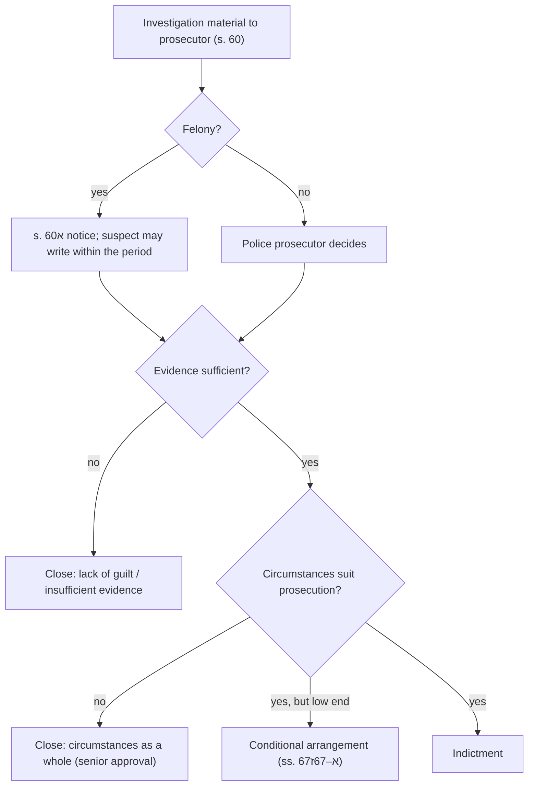

# 24.5 · Prosecution decisions: closing a file, conditional arrangements and the pre-indictment hearing

This lesson is about the moment the investigation ends and a prosecutor decides your fate: indict, close the file, or offer a conditional arrangement. You will learn the legal test for each, why the stated ground for closing a file matters for years afterwards, what a conditional arrangement really costs, and how a suspect uses the s. 60א right to write to the prosecution before a felony indictment. Lab [24.9](lesson-09.md) has you draft the request.

## Why it matters

> [!WARNING]
> This lesson is written for a suspect's lawful self-protection. Writing to the prosecution under s. 60א is a right; how much to reveal about your defence is a tactical decision with real risks, because what you write may be used later. In felony cases, get a lawyer or the Public Defender to write it or check it. Never contact the complainant or witnesses to "settle" a criminal file.

For most suspects the prosecution's decision matters more than any trial: most files never reach a courtroom. A file closed for "lack of guilt" disappears from the police record; a file closed for "insufficient evidence" stays there and can surface in a job application years later; a conditional arrangement avoids a conviction but needs an admission and is recorded. The s. 60א letter is the one point at which a felony suspect can address the decision-maker before it is made. The law also lets the suspect ask, after closure, to change the ground (s. 62(ב)(4)). These are among the most valuable and least used rights in the system.

## Key terms

| עברית | Transliteration | English |
|---|---|---|
| סגירת תיק | sgirat tik | closing a file |
| עילת סגירה | ilat sgira | closure ground |
| חוסר אשמה | choser ashma | lack of guilt |
| חוסר ראיות מספיקות | choser ra'ayot maspikot | insufficient evidence |
| נסיבות העניין בכללותן אינן מתאימות | nesibot ha'inyan bichlalutan einan mat'imot | the circumstances as a whole do not suit prosecution (formerly "no public interest") |
| הסדר מותנה (סגירת תיק בהסדר) | hesder mutne | conditional arrangement |
| טיוטת כתב אישום | tyutat ktav ishum | draft indictment |
| שימוע / פנייה לפי סעיף 60א | shimu'a | pre-indictment hearing / request under s. 60א |
| רשות התביעה | rashut hatvi'a | prosecuting authority |

## The law

### The decision to indict: s. 62(א)

> ראה תובע שהועבר אליו חומר החקירה שהראיות מספיקות לאישום אדם פלוני, יעמידו לדין, זולת אם היה סבור שנסיבות העניין בכללותן אינן מתאימות להעמדה לדין…

*Gist:* A prosecutor who finds the evidence sufficient shall indict, unless the circumstances as a whole do not suit prosecution; closing on that ground needs approval by a listed senior official (s. 62(א)(1)–(4)). ([CPL s. 62](https://he.wikisource.org/wiki/חוק_סדר_הדין_הפלילי#סעיף_62)) "Sufficient evidence" in practice means a reasonable prospect of conviction; the policy test ("the circumstances as a whole") replaced the older "lack of public interest" and its wording to the suspect is fixed in the Seventh Schedule: an event "שההליך הפלילי אינו מסגרת מתאימה לבירורו" — for which criminal proceedings are not the right framework.

### Notice to the suspect and changing the ground: s. 62(ב)

> (1) על החלטה שלא להעמיד לדין תימסר לחשוד הודעה בכתב בלא ציון עילת סגירת התיק, ואולם יצוין בה כי החשוד רשאי לברר את עילת סגירת התיק באמצעות הגעה לכל תחנת משטרה…

*Gist:* The suspect is told in writing that the file was closed, without the ground, but may learn the ground at any police station or in other ways stated in the notice; in sexual or violent offences the ground is stated (s. 62(ב)(1)–(2)).

> (4) החשוד יהיה רשאי לפנות לתובע שסגר את התיק בבקשה מנומקת לשנות את עילת הסגירה; תיק שנסגר בשל חוסר אשמה, יוסר רישומו מהמרשם המשטרתי…

*Gist:* The suspect may ask the prosecutor who closed the file, with reasons, to change the ground; a file closed for lack of guilt is removed from the police record. The complainant's side (notice and appeal, ss. 63–64) is in lesson [05.8](../module-05/lesson-08.md). In sexual or violent offences against a spouse, the complainant's wish alone is not a reason to close (s. 62א).

### Conditional arrangement: ss. 67א–67ז

A prosecutor who has sufficient evidence may, instead of indicting, offer the suspect an arrangement if the circumstances as a whole make non-prosecution suitable given the arrangement and its conditions (s. 67א(ב)). Limits:

- **Offences:** contraventions, misdemeanours, and felonies listed in the Sixth Schedule; not offences in s. 240 (minor traffic-type offences), offences that can be dealt with by a monetary sanction or ransom (כופר) (s. 67א(ג)).
- **Sentence and record:** the fitting sentence would not include actual imprisonment, and the suspect has no record entry in the five years before the offence, including a previous arrangement, and no other pending file (s. 67א(ד)).
- **Not for minors** (s. 67א(ו)).

The suspect admits the facts in a draft indictment and meets conditions; the prosecutor undertakes to close the file (s. 67ב). Conditions may include a payment to the Treasury and compensation to the victim, each capped by reference to Penal Law s. 61(א)(2); an undertaking to refrain from an offence; a treatment programme set by a probation officer; and steps to repair the harm, usually for up to a year (s. 67ג; [current numbers](../../references/current-numbers.md)). Before signing, the suspect may inspect the investigation material and the draft indictment (s. 67ד).

> (ו) הודיית חשוד בעובדות המהוות עבירה, במסגרת הסדר, לא תשמש ראיה נגדו בהליך פלילי בשל עובדות אלה.

*Gist:* The admission in the arrangement may not be used as evidence against the suspect in criminal proceedings on those facts (s. 67ז(ו)). If he refuses, he is indicted on the draft unless new information leads to closure (s. 67ז(א)); if he breaches, he is indicted, and the arrangement is cancelled (s. 67ז(ג)–(ד)); if indicted after an arrangement was offered, the prosecutor may not ask for actual imprisonment without new information and a senior prosecutor's approval (s. 67ז(ה)). The file is closed on the ground "סגירה בהסדר", which is recorded in the police record (s. 67ו; Criminal Information Law s. 27(א)(2)(ג)). Anonymised arrangements are published on the prosecutor's website (s. 67ח).

### The pre-indictment request: s. 60א

> (א) רשות התביעה שאליה הועבר חומר חקירה הנוגע לעבירת פשע תשלח לחשוד הודעה על כך…
> (ד) חשוד רשאי, בתוך 30 ימים מיום קבלת ההודעה, לפנות בכתב לרשות התביעה… בבקשה מנומקת, להימנע מהגשת כתב אישום, או מהגשת כתב אישום בעבירה פלונית…

*Gist:* In a felony, the prosecuting authority notifies the suspect that the material has reached it, giving an address for inquiries and arguments (s. 60א(א)–(ב)); the suspect may, within the period, ask in writing with reasons not to be indicted or not for a particular offence, and senior prosecutors may extend the time (s. 60א(ד)). A notice by registered mail is deemed served (s. 60א(ג)). The district attorney may indict earlier for recorded reasons (s. 60א(ה)); the suspect remains entitled to s. 74 inspection after indictment (s. 60א(ו)); the notice does not apply to someone held in custody and indicted while in custody (s. 60א(ז)) or to offences excluded by regulations (assault of a family member and actual bodily harm to a spouse, by 2005 regulations). The Administrative Procedure Amendment (Decisions and Reasons) Law does not apply, but the suspect gets written notice of the decision as soon as possible and may be invited to argue orally (s. 60א(ח)). ([CPL s. 60א](https://he.wikisource.org/wiki/חוק_סדר_הדין_הפלילי#סעיף_60א); period in [current numbers](../../references/current-numbers.md))

Misdemeanours carry no statutory notice, but nothing prevents a suspect who knows the file went to a police prosecutor from writing to the prosecution unit; whether it is considered is at its discretion.

## Leading cases

### בג״ץ 3292/07 עדאלה נ׳ היועץ המשפטי לממשלה (2011)

You read this case in lesson 05.8 from the complainant's side. Here notice the other face of the same principle: the High Court required a suitable prima facie foundation and showed restraint in reviewing the decisions of the Attorney General and the Military Advocate General not to investigate; courts generally intervene in prosecution decisions only in exceptional cases. Why it matters for a suspect: the real chance to influence the decision is before it is made, in the s. 60א request or the request to change the closure ground, not in a later petition. [English translation](https://larc.cardozo.yu.edu/iscp-opinions/24)

### Key texts instead of further cases

Litigation about s. 60א is mostly unpublished or behind paid databases; the decisive texts are the statute (ss. 60א, 62, 67א–67ז) and the Attorney General's guidelines on hearings before indictment and on closure grounds (published on the Attorney General's guidelines page on gov.il; ⚠️ manual check for the current number and version). A court will not normally cancel an indictment because a hearing was not held, unless the failure caused real injustice (compare s. 149(10), lesson [24.6](lesson-06.md)).

## How it works in practice

### The prosecutor's options

### Closure grounds and the police record

| Ground | Meaning | Police record (lesson [24.8](lesson-08.md)) |
|---|---|---|
| חוסר אשמה (lack of guilt) | The suspect did not commit the offence, or no offence occurred | Removed (s. 62(ב)(4)) |
| חוסר ראיות מספיקות (insufficient evidence) | Not enough to convict | Stays as a "closed file"; may be cancelled later (Criminal Information Law ss. 27, 33) |
| נסיבות העניין בכללותן אינן מתאימות (circumstances as a whole) | Evidence may suffice, but prosecution is not suitable | Stays as a closed file |
| סגירה בהסדר (conditional arrangement) | Admission and conditions met | Stays as a closed file |
| עבריין לא נודע / התיישנות (offender unknown / limitation) | Practical grounds | Usually not against a named suspect / stays |

A suspect whose file was closed for insufficient evidence but who believes he is innocent should ask, with reasons and documents, to change the ground to lack of guilt (s. 62(ב)(4)). The template in lesson [24.10](lesson-10.md) covers both this request and a request to cancel a police record.

### Writing a s. 60א request: what works

- **Diary the period** from the day you received the notice; ask for an extension in writing before it ends, and ask to see the material (practice under the Attorney General's guidelines allows partial disclosure at this stage; full inspection is a right only after indictment, s. 74).
- **Structure:** identification and file number; a short summary of the suspicion as you understand it; the factual answer (only what you can support); legal arguments (an element missing, a defence such as self-defence, lesson [05.4](../module-05/lesson-04.md)); personal circumstances (age, record, work, family, health, harm from a conviction); the requested outcome and alternatives (close; a lesser charge; a conditional arrangement); a request to present orally (s. 60א(ח)).
- **Evidence:** attach documents the investigators did not have: receipts, messages, medical papers, employer letters. Do not attach a new detailed statement on disputed facts without legal advice.
- **Tone:** factual and respectful; the reader is a prosecutor deciding many files.

### Neutrality note

Conditional arrangements are praised for diverting minor offenders from conviction and criticised for pressuring people to admit to avoid risk, and for being available mainly to those who can pay. Pre-indictment hearings are praised as fair process and criticised as a privilege used mostly by well-represented suspects. Both views have empirical support; the law reflects a compromise.

## Worked example

Tomer Avraham, 34, an electrician from Rishon LeZion, was questioned after a neighbour complained that Tomer had threatened him during a parking dispute and damaged his car mirror. Tomer admits shouting but denies threats and damage.

1. **No s. 60א letter.** Threats (Penal Law s. 192) and malicious damage (s. 452) are misdemeanours, so Tomer receives no s. 60א notice; a police prosecutor decides.
2. **Two outcomes.** The prosecutor offers a conditional arrangement: Tomer would admit to threats, pay a sum to the Treasury and compensation for the mirror, and undertake to refrain from offences for a year.
3. **Tomer's choice.** He inspects the material and the draft indictment first (s. 67ד). The mirror evidence is weak (no camera), but there is a recording of his shouting "אני אשבור לך את הפנים". He has no record. His options: sign (no conviction; a closed-file entry; the admission cannot be used against him, s. 67ז(ו)); refuse and face an indictment on the draft, but with a cap: the prosecutor may not seek actual imprisonment without new information (s. 67ז(ה)).
4. **Advice.** With a consultation, he decides to sign, after the prosecutor agrees to drop the damage count from the draft. After a year, the file is closed "בהסדר". He diaries the date when he may ask to cancel the police record (lesson 24.8).
5. **Variation.** Had the charge been aggravated assault (a felony), he would have received a s. 60א notice and could have written within the period, asking to close the file or for an arrangement if the offence is in the Sixth Schedule.

## Do it yourself

### You need

- CPL ss. 60א, 62, 67א–67ז and the Seventh Schedule (link above).
- The Tomer Avraham case, or the Dvir Shalom case from lesson [08.4](../module-08/lesson-04.md).
- 45 minutes.

### Steps

1. **Eligibility check (10 min).** For Tomer, go through s. 67א(ג)–(ו) line by line and write "met / not met / unknown" with the reason.
2. **Closure ground (10 min).** Write which ground Tomer should hope for, which he will likely get if the prosecutor drops the case, and what he can ask under s. 62(ב)(4).
3. **s. 60א outline (25 min).** For Dvir Shalom (a felony), write the headings and one paragraph under each, using the [pre-indictment request](../../templates/pre-indictment-hearing-request.md) template. Mark every factual statement you would check with a lawyer before sending.

### Template

[Pre-indictment request under s. 60א (פנייה לרשות התביעה לפי סעיף 60א)](../../templates/pre-indictment-hearing-request.md).

### How you know it worked

- Your eligibility check names the offence class, the absence of a five-year record and the "no actual imprisonment" test.
- You can explain why "lack of guilt" is the ground to ask for, and its record effect.
- Your s. 60א outline asks for a specific outcome and an alternative, and attaches evidence rather than a new long statement.

### Self-check

- [ ] I know a prosecutor with sufficient evidence indicts unless the circumstances as a whole do not suit prosecution.
- [ ] I know the suspect may ask to change the closure ground, and that lack of guilt removes the police record.
- [ ] I know the conditions and limits of a conditional arrangement, and that the admission is not evidence against me.
- [ ] I know the s. 60א period starts when the notice is received.

## Without a lawyer

### Can you do this yourself?

Partly. You may write a s. 60א request or a request to change the closure ground yourself; the law gives the right to the suspect. In felony cases, a lawyer should write or check it: a careless factual statement can harm your defence. Before signing a conditional arrangement, take advice; the Public Defender represents some eligible suspects (Public Defender Law s. 18(א)(5)) and you can ask; otherwise a private consultation. See [can I act without a lawyer](../../references/can-i-act-without-a-lawyer.md).

### Where and how

- s. 60א request: the address in the notice (district attorney's office or police prosecution unit), by registered mail or email with proof; period in [current numbers](../../references/current-numbers.md).
- Learning the closure ground: any police station, or the channels listed in the notice (s. 62(ב)(1)); ⚠️ check the police website for an online channel.
- Request to change the ground: to the prosecutor who closed the file (s. 62(ב)(4)).

> [!IMPORTANT]
> Act in your own name only. This is not legal advice — check current rules before filing.

### Stop and get a lawyer when

- You received a s. 60א notice in any felony.
- You are offered a conditional arrangement or a "deal" before indictment.
- Your request would require you to describe disputed facts in detail.
- There are other suspects or a parallel civil or disciplinary proceeding.

## What goes wrong

| Mistake | Consequence | How to fix | How to avoid |
|---|---|---|---|
| Ignoring the s. 60א notice | Indictment without your input | Write late with reasons and ask for an extension | Diary the period the day it arrives |
| A long new statement in the request | It may be used to contradict you at trial | Through a lawyer, limit to documents and legal argument | Get advice before sending |
| Signing an arrangement without reading the material | Admitting to facts you could have contested | Before signing, use s. 67ד | Inspect and negotiate the draft first |
| Not checking the closure ground | Closed file stays in the police record | Ask to change the ground (s. 62(ב)(4)) | Ask at a station soon after closure |
| Breaching an arrangement condition | Indictment on the draft (s. 67ז(ג)) | Explain to the prosecutor before the period ends | Diary every condition and deadline |

## Review

- A prosecutor with sufficient evidence indicts unless the circumstances as a whole do not suit prosecution (s. 62(א)).
- The closure ground matters: lack of guilt removes the police record; you may ask to change the ground (s. 62(ב)(4)).
- Conditional arrangements: low-level offences, no prison, no recent record, admission and conditions; the admission is not evidence against you (ss. 67א–67ז).
- Felony suspects are notified and may write a reasoned request within the period (s. 60א).
- Courts review prosecution decisions narrowly (Adalah); influence the decision before it is made.

### Learn more

- Wikisource, Criminal Procedure Law, ss. 60א–67ז: <https://he.wikisource.org/wiki/חוק_סדר_הדין_הפלילי#סעיף_60א>. FREE-FULL, 30 minutes. Fallback: the Knesset legislation database (search "חוק סדר הדין הפלילי").
