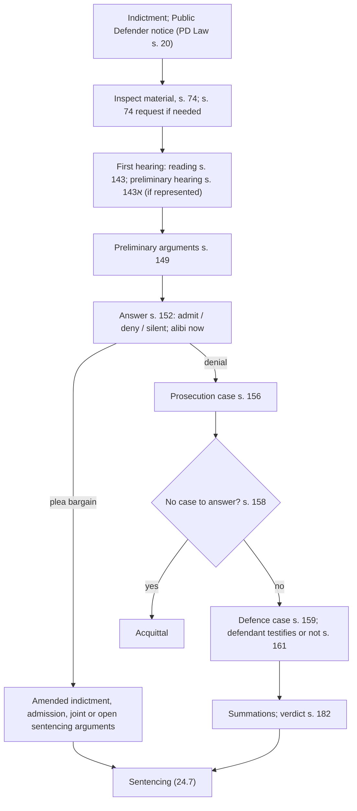

# 24.6 · The trial: the plea, plea bargains and the defence case

This lesson walks through a criminal trial in Israel from the defence's chair: disclosure of the investigation material, the first hearing, preliminary arguments, the answer to the charge, the plea bargain that ends most cases, and, when there is no deal, the prosecution case, the "no case to answer" submission and the defence case. It covers what a Bar-exam candidate must know and what a defendant in a minor case needs to manage the trial himself.

## Why it matters

> [!WARNING]
> A criminal trial can end in a conviction, a record and prison. Defend yourself only in minor matters, such as a fine offence you asked to be tried for or a traffic offence without injury (lab [24.9](lesson-09.md)). In anything else, use a lawyer or ask for the Public Defender: the court must appoint a defender in the cases in s. 15, and may not impose actual imprisonment on a defendant without one (s. 15ב).

Most Israeli criminal cases end without a full trial: by an admission in a plea bargain, by an admission at the first hearing, or by a withdrawal. That makes the early stages decisive. What the defence learns from the investigation material (s. 74), which preliminary arguments it raises (s. 149), and how the defendant answers the charge (s. 152) shape the bargaining position. When there is a trial, the rules on the order of evidence, the defendant's choice to testify, and the "no case to answer" submission decide it. The constitutional frame from lesson [24.1](lesson-01.md) runs through all of it: a fair trial is a right, and s. 149(10) lets a court cancel an indictment that offends basic fairness.

## Key terms

| עברית | Transliteration | English |
|---|---|---|
| עיון בחומר החקירה | iyun bechomer hachakira | inspection of the investigation material |
| רשימת כל החומר | reshimat kol hachomer | list of all material collected |
| הקראה | hakra'a | first hearing (reading of the indictment) |
| טענות מקדמיות | ta'anot mukdamot | preliminary arguments |
| מענה לאישום / כפירה / הודיה | ma'ane la'ishum / kfira / hodaya | answer to the charge / denial / admission |
| הסדר טיעון | hesder ti'un | plea bargain |
| טענת "אין להשיב לאשמה" | ein lehashiv la'ashma | "no case to answer" submission |
| פרשת התביעה / פרשת ההגנה | parashat hatvi'a / parashat hahagana | prosecution case / defence case |
| הכרעת דין | hachra'at din | verdict |
| הגנה מן הצדק | hagana min hatzedek | protection from injustice |

## The law

### Appointing a defender: ss. 15–15ב

The court appoints a defender for an unrepresented defendant charged with murder or an offence punishable by death or life imprisonment, or with an offence of ten years or more in the district court; a minor under 16 in a court other than the juvenile court; a defendant who is mute, blind, deaf or may be mentally ill or impaired; an offence carrying mandatory actual imprisonment; where the prosecutor gave notice that it may seek actual imprisonment; and where, after conviction, the court thinks actual imprisonment possible (s. 15(א)). It may appoint for a defendant without means (s. 15(ג)). The prosecutor must give the notice of possible actual imprisonment with the indictment or before the trial (s. 15א).

> לא יטיל בית משפט עונש מאסר בפועל על נאשם שאינו מיוצג…

*Gist:* A court shall not impose actual imprisonment on an unrepresented defendant, except one whose representation ended with leave under s. 17 (s. 15ב). ([CPL ss. 15–15ב](https://he.wikisource.org/wiki/חוק_סדר_הדין_הפלילי#סעיף_15)) "Actual imprisonment" excludes fully concurrent prison, prison instead of an unpaid fine, and prison for refusing an undertaking (s. 15א(ד)).

### Inspecting the investigation material: s. 74

After an indictment for a felony or misdemeanour the defendant and his defender may inspect and copy, at any reasonable time, the investigation material and the list of everything collected or recorded that relates to the charge (s. 74(א)(1)), including intelligence material only where it relates to the facts, the evidence or a central witness's credibility (s. 74(א)(2)). The prosecutor must ensure the material is available when the indictment is filed or soon after (s. 74(א1)). A dispute goes to a single judge, preferably not the trial judge, on a request under s. 74(ב); the decision can be appealed within 30 days (s. 74(ה)); privilege certificates under the Evidence Ordinance are not affected (s. 74(ו)). ([CPL s. 74](https://he.wikisource.org/wiki/חוק_סדר_הדין_הפלילי#סעיף_74)) Material the prosecution did not collect is reached by a court order for documents under s. 108.

### The first hearing and the preliminary hearing: ss. 143–145

The court reads the indictment to the defendant and explains it if needed, unless a defender confirms he did so (s. 143); it explains to the defendant his rights in his defence where needed (s. 145). With the consent of a represented defendant and the prosecutor, the court may hold a **preliminary hearing** (דיון מקדמי) to clarify admissions, narrow disputes and try to end the case, before a judge who will not try the case if it does not end there; its protocol is not passed to the trial judge (s. 143א). A defendant summoned to such a hearing is eligible for the Public Defender (Public Defender Law s. 18(א)(16)).

### Preliminary arguments: ss. 149–151

> לאחר תחילת המשפט רשאי הנאשם לטעון טענות מקדמיות, ובהן – (1) חוסר סמכות מקומית; (2) חוסר סמכות ענינית; (3) פגם או פסול בכתב האישום; (4) העובדות המתוארות בכתב האישום אינן מהוות עבירה; (5) זיכוי קודם או הרשעה קודמת…; (6) משפט פלילי אחר תלוי ועומד…; (7) חסינות; (8) התיישנות; (9) חנינה; (10) הגשת כתב האישום או ניהול ההליך הפלילי עומדים בסתירה מהותית לעקרונות של צדק והגינות משפטית.

*Gist:* After the trial begins the defendant may raise preliminary arguments, among them lack of territorial or subject-matter jurisdiction, a defect in the indictment, facts that are not an offence, previous acquittal or conviction, another pending trial, immunity, limitation, pardon, and a substantial contradiction with justice and legal fairness. ([CPL s. 149](https://he.wikisource.org/wiki/חוק_סדר_הדין_הפלילי#סעיף_149)) The prosecutor is heard and the court decides at once or later (s. 150). Arguments not raised now may be raised later, except territorial jurisdiction and a defect in the indictment, which need leave (s. 151).

### The answer to the charge: ss. 152–155

The defendant may decline to answer, admit or deny the facts in whole or in part, and add facts; silence may strengthen the prosecution's evidence, and the court must explain this (s. 152(א)–(ב)). An alibi must be raised at once, with the place, or it needs the court's leave later (s. 152(ג)–(ד)). An admitted fact is proved against the defendant (s. 154) unless the court allows him, for special reasons, to retract (s. 153).

### The prosecution case, no case to answer and the defence case: ss. 156–162

The prosecution proves the facts not admitted (s. 156) and announces the end of its case (s. 157).

> נסתיימה פרשת התביעה ולא הוכחה האשמה אף לכאורה, יזכה בית המשפט את הנאשם…

*Gist:* If, at the end of the prosecution case, guilt has not been proved even prima facie, the court acquits, on the defendant's submission or its own initiative, after hearing the prosecutor (s. 158). Otherwise the defence may open and bring evidence (s. 159). The defendant chooses whether to testify (and be cross-examined) or not; if he testifies he does so first, unless the court allows otherwise (s. 161); not testifying may strengthen the prosecution's evidence and serve as corroboration where needed, with exceptions for people with intellectual or mental disabilities (s. 162). The verdict is reasoned and in writing, read in public; an acquittal is announced first (s. 182).

## Leading cases

### דנ״פ 1187/03 מדינת ישראל נ׳ פרץ (31.3.2005)

In two cases the trial court rejected a plea bargain and imposed heavier sentences; on appeal the State defended the heavier sentences rather than the bargains it had signed. An expanded panel of nine held that as a rule the prosecution must defend, on appeal, the plea bargain it made, even if the trial court rejected it, because a plea bargain is a commitment by a public authority on which the defendant relied by admitting; it may depart only in exceptional circumstances. Why it matters: the court is not bound by a plea bargain, but the prosecution is; a defendant who admits under a bargain has a protected expectation. You met the sentencing side in lesson [05.6](../module-05/lesson-06.md). [English translation](https://versa.cardozo.yu.edu/opinions/state-israel-v-peretz)

### ע״פ 4855/02 מדינת ישראל נ׳ בורוביץ (2005)

The Supreme Court set the test for protection from injustice, later codified in s. 149(10): first, identify the flaws in the proceedings and their strength, regardless of the defendant's guilt; second, ask whether conducting the trial despite them would seriously offend the sense of justice and fairness, balancing the public interest in prosecution against the harm to the defendant; third, consider whether less drastic remedies (narrowing the charge, a lighter sentence, excluding evidence) can cure the harm before cancelling the indictment. Why it matters: selective enforcement, gross delay, misleading promises by the authorities or abusive investigation methods can be raised, but cancellation is the exception. Free source: [Hebrew Wikipedia, "הגנה מן הצדק"](https://he.wikipedia.org/wiki/הגנה_מן_הצדק) (secondary; earlier origin in ע״פ 2910/94 יפת).

### בג״ץ 9264/04 מדינת ישראל נ׳ בית משפט השלום בירושלים (6.6.2005)

Recap from lesson [08.4](../module-08/lesson-04.md): the s. 74 test is relevance and a real chance that the material will help the defence, balanced against third parties' privacy, which must be heard. Why it matters here: a s. 74 request is often the first fight in a trial and the source of the material that drives plea negotiations. [English translation](https://versa.cardozo.yu.edu/opinions/state-israel-v-jerusalem-magistrates-court)

## How it works in practice

### The trial step by step

### Plea bargains in practice

Plea bargains are not regulated in one statute; they rest on the prosecutor's discretion, the defendant's admission and the court's approval, with victims' rights to be heard in serious cases (Crime Victims' Rights Law s. 17; lesson 05.6). Typical forms:

- **Charge bargain:** the indictment is amended to a lesser offence or fewer counts.
- **Sentence bargain:** a joint recommendation (עונש מוסכם), a range (each side argues within limits), or "open" arguments with an agreed amended indictment.
- **Probation-report bargain:** the parties agree to wait for a probation report, sometimes with the option of cancelling the conviction (s. 192א, lesson [24.7](lesson-07.md)).

The court is not bound by the bargain but, in practice, follows a joint recommendation unless it falls far outside the proper range; if it intends to depart, it should let the defendant withdraw or explain itself, and on appeal the prosecution defends the bargain (Peretz). Before signing, a defendant should understand exactly which facts he admits, what will appear in the criminal register (lesson [24.8](lesson-08.md)), and the consequences for licences, professions and immigration.

### A defendant in person: what to prepare

In a minor case you may defend yourself. Prepare: the indictment and every document served; your request to inspect the material (to the prosecutor first); a short list of preliminary arguments that really apply (limitation and "facts that are not an offence" are the most common in minor cases); your answer to each paragraph of the indictment (admit / deny / do not know); your witnesses and documents; and questions for each prosecution witness (module 23 covers examination). The [hearing-day kit](../../templates/hearing-day-kit.md) works for criminal hearings too.

## Worked example

Avraham Tesfaye, 45, a bus driver from Netanya, is indicted in the magistrates' court for assault (Penal Law s. 379) after an argument with a passenger who refused to pay; the passenger says Avraham pushed him off the bus; Avraham says the passenger fell while kicking the door.

1. **Defender.** The prosecutor did not give notice of seeking actual imprisonment, so appointment is not mandatory. Avraham earns little and asks the Public Defender; under s. 15(ג) and the means criteria, the court may appoint one. He is eligible and gets a defender.
2. **Material.** The defender inspects the material (s. 74) and finds that the bus camera footage is listed but was not copied into the file; she asks the prosecutor, then the court (s. 74(ב)). The footage shows the passenger kicking the door and falling backwards.
3. **Preliminary arguments.** None strong: jurisdiction, indictment and limitation are fine.
4. **Answer.** Avraham denies the push and adds that the passenger kicked the door (s. 152(א)).
5. **Negotiation.** With the footage, the prosecutor withdraws the charge (s. 93). Had she not, the defence would have submitted at the end of the prosecution case that there was no case to answer (s. 158).

Variation: had Avraham represented himself, the court could not have sentenced him to actual imprisonment (s. 15ב), and the judge would have explained his rights (s. 145) and the effect of not testifying (s. 161(ב)).

## Do it yourself

### You need

- CPL ss. 15–15ב, 74, 143–162, 182 (link above).
- A real indictment from a news report or court publication, or the Avraham Tesfaye case.
- 45 minutes.

### Steps

1. **Preliminary arguments scan (15 min).** Go through s. 149(1)–(10) against the indictment; for each, write "applies / does not / need facts", with a one-line reason.
2. **Answer table (15 min).** Make a table with each paragraph of the indictment, your answer (admit / deny / no knowledge) and the evidence you would rely on.
3. **Plea-bargain checklist (15 min).** Write the eight questions a defendant must have answered before signing: which facts, which offence, which sentence, register entry and its periods, licences and profession, immigration, the victim's position, and what happens if the court rejects it.

### Template

[Hearing-day kit](../../templates/hearing-day-kit.md) (use its checklist and argument outline for a criminal hearing).

### How you know it worked

- Your scan treats s. 149(10) with the three Borovitz steps, not as a general complaint.
- Your answer table never "admits" a fact you cannot be sure of.
- Your checklist includes the record consequences and the "court not bound" point.

### Self-check

- [ ] I know when the court must appoint a defender and that an unrepresented defendant cannot be sent to actual prison.
- [ ] I know which preliminary arguments need leave if raised late.
- [ ] I know an alibi must be raised in the answer to the charge.
- [ ] I know the prosecution must defend a plea bargain it made (Peretz).
- [ ] I know the "no case to answer" test (s. 158).

## Without a lawyer

### Can you do this yourself?

Partly. Any defendant may conduct his own defence, but in the cases of s. 15(א) the court must appoint a defender; with no defender, actual imprisonment is barred (s. 15ב), which in practice pushes most serious cases to representation. Self-representation is realistic in fine offences you asked to be tried for, traffic offences without injury and minor municipal offences. See [can I act without a lawyer](../../references/can-i-act-without-a-lawyer.md).

### Where and how

- The court registry or Net HaMishpat for filings in your file; requests to inspect material go first to the prosecutor (address on the indictment).
- Public Defender: the indictment comes with a notice that you may ask for one (Public Defender Law s. 20); apply to the district office (s. 21) or ask the judge at the first hearing.
- Deadlines (s. 74 appeal; appeal after verdict): [current numbers](../../references/current-numbers.md).

> [!IMPORTANT]
> Act in your own name only. This is not legal advice — check current rules before filing.

### Stop and get a lawyer when

- The prosecutor gave notice that it may seek actual imprisonment (s. 15א).
- You are offered a plea bargain.
- The case turns on a confession, forensic evidence or a child witness.
- You have a previous record, or a conviction would affect a licence, profession or residence status.

## What goes wrong

| Mistake | Consequence | How to fix | How to avoid |
|---|---|---|---|
| Admitting facts at the first hearing "to be honest" | The facts are proved against you (s. 154) | Ask leave to retract, for special reasons (s. 153) | Answer only after reading the material |
| Raising an alibi late | Needs leave (s. 152(ד)) | Ask leave with reasons | Raise it in the answer, with the place |
| Raising a defect in the indictment late | Needs leave (s. 151) | Ask leave | Scan s. 149 at the start |
| Signing a plea bargain without checking the register | A long record you did not expect | Ask your lawyer about a s. 192א request | Ask about the record before signing |
| Testifying without preparation | Damaging cross-examination | — | Decide with a lawyer; prepare with documents |

## Review

- The court must appoint a defender in the s. 15 cases; actual imprisonment cannot be imposed on an unrepresented defendant (s. 15ב).
- After indictment the defence may inspect all investigation material and the list of everything collected (s. 74; HCJ 9264/04).
- Preliminary arguments (s. 149) include protection from injustice, decided by the Borovitz three steps.
- The defendant answers the charge, may stay silent at a cost, and must raise an alibi at once (s. 152).
- Most cases end in plea bargains; the court is not bound, but the prosecution must defend its bargain (Peretz). If the prosecution case is too weak, the court acquits at half-time (s. 158).

### Learn more

- Cardozo Israeli Supreme Court Project, State of Israel v. Peretz (CrimFH 1187/03): <https://versa.cardozo.yu.edu/opinions/state-israel-v-peretz>. FREE-FULL, 45 minutes. Fallback: search "Peretz" at <https://versa.cardozo.yu.edu/>.
