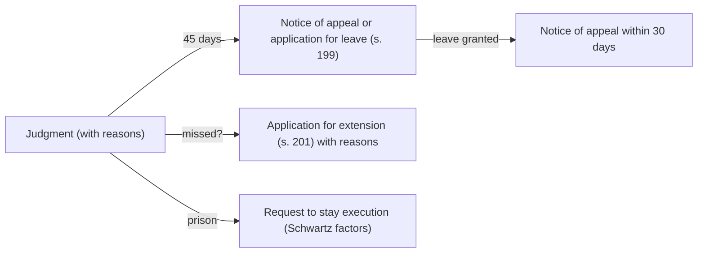

# 24.7 · Sentencing and appeals

This lesson covers what happens after a verdict of guilty: the sentencing hearing, the probation report, the option of cancelling the conviction, and the routes of appeal, including leave to appeal, late appeals and staying a prison sentence while the appeal is pending. Lesson [05.6](../module-05/lesson-06.md) taught the substantive law of sentencing under Amendment 113; this lesson is the procedure that delivers it and the way to challenge it.

## Why it matters

> [!WARNING]
> Sentencing and appeals in any case that may involve prison need a lawyer or the Public Defender. This lesson helps you understand the hearing, gather the documents that matter, and avoid missing a deadline. In minor matters, such as a traffic or fine-offence conviction, you may file an appeal yourself, but read the deadlines carefully.

Two things make sentencing procedure decisive. First, for a first offender the most valuable result is often not a lighter sentence but no conviction at all: the court may convict, then cancel the conviction and order probation or community service (s. 192א). The record consequences (lesson [24.8](lesson-08.md)) are completely different. Second, appeals run on short deadlines and fixed routes: the right of appeal from a magistrates' court is lost after 45 days unless the court extends it, and a second appeal needs leave. People lose good arguments by missing dates, not by losing them.

## Key terms

| עברית | Transliteration | English |
|---|---|---|
| טיעונים לעונש | ti'unim la'onesh | sentencing arguments |
| תסקיר שירות המבחן | taskir sherut hamivchan | probation service report |
| הצהרת נפגע | hatzharat nifga | victim statement |
| ביטול הרשעה / אי הרשעה | bitul harsha'a / i harsha'a | cancelling a conviction / non-conviction |
| צו מבחן / של״צ | tzav mivchan / shelatz | probation order / community service (שירות לתועלת הציבור) |
| ערעור בזכות | ir'ur bizchut | appeal as of right |
| בקשת רשות ערעור (רע״פ) | bakashat reshut ir'ur | application for leave to appeal |
| הארכת מועד | ha'arachat mo'ed | extension of time |
| עיכוב ביצוע עונש | ikuv bitzu'a onesh | stay of execution of a sentence |
| משפט חוזר | mishpat chozer | retrial |

## The law

### The sentencing hearing: ss. 187–192

After conviction, the prosecutor brings evidence of the defendant's previous convictions and court decisions about offences, even without conviction, and may bring other evidence on sentence (s. 187(א)); in sexual offences and violent offences that caused death, the court may order a victim-impact report with the victim's consent (s. 187(ב)–(ג)). The defendant may testify, make a statement without cross-examination, and bring evidence in mitigation (s. 189). Probation and other reports are disclosed to both sides, who may respond (s. 191). Then each side argues (s. 192). The victim's right to submit a statement on harm is in the Crime Victims' Rights Law (lesson [05.6](../module-05/lesson-06.md)).

### Cancelling the conviction: s. 192א

> הרשיע בית המשפט את הנאשם, ולפני מתן גזר הדין ראה שיש מקום לתת לגביו צו מבחן או צו שירות לתועלת הציבור, ללא הרשעה, או לצוות כי הנאשם ייתן התחייבות להימנע מעבירה… בלא הרשעה, רשאי הוא לבטל את ההרשעה ולצוות כאמור.

*Gist:* After convicting, and before sentencing, the court may cancel the conviction and order probation, community service or an undertaking to refrain from offences, without a conviction. ([CPL s. 192א](https://he.wikisource.org/wiki/חוק_סדר_הדין_הפלילי#סעיף_192א)) The case law treats this as exceptional and generally requires two things: that a conviction would seriously harm the defendant's rehabilitation or future (a concrete harm, such as losing a profession), and that the type and circumstances of the offence allow giving up the conviction without serious harm to other sentencing considerations. Such orders still appear in the criminal register, with shorter periods (Criminal Information Law ss. 8(א)(2), 22(5); lesson 24.8).

### Appeal: ss. 198–199, 201

An appeal by the defendant or the prosecutor is filed as a reasoned notice of appeal to the appeal court (s. 198).

> התקופה להגשת הערעור היא ארבעים וחמישה ימים מיום מתן פסק הדין, ואם ניתנה הכרעת הדין ללא נימוקים – מיום מתן הנימוקים; היתה דרושה רשות לערער, תוגש בקשת הרשות תוך אותה תקופה…

*Gist:* The appeal period is 45 days from the judgment (from the reasons, if the verdict was given without them); where leave is needed, the application is filed in the same period and the notice of appeal within 30 days of leave (s. 199). The court may allow a late appeal or application (s. 201). ([CPL ss. 198–201](https://he.wikisource.org/wiki/חוק_סדר_הדין_הפלילי#סעיף_198); [current numbers](../../references/current-numbers.md))

Routes: from a magistrates' court to the district court, as of right; from the district court as a first instance to the Supreme Court, as of right; a second appeal (from the district court sitting on appeal) to the Supreme Court only with leave (רע״פ), given in practice only for a question of general importance or a serious miscarriage of justice. The court may treat an application for leave as an appeal (s. 205).

### The appeal court's powers: ss. 211–217

The appeal court may take evidence or order the lower court to do so when needed for justice (s. 211); allow or dismiss the appeal, change or replace the judgment, or send the case back (s. 213).

> בית המשפט לא יגדיל עונש שהוטל על נאשם, אלא אם הוגש ערעור על קולת העונש.

*Gist:* The appeal court will not increase a sentence unless an appeal against its leniency was filed (s. 217). A defendant's own appeal therefore cannot make his sentence heavier, though a prosecution appeal can.

### Beyond appeal

A further hearing (דיון נוסף) in the Supreme Court and a retrial (משפט חוזר, Courts Law s. 31) are exceptional; the Public Defender may represent eligible people seeking a retrial (Public Defender Law s. 18(א)(9)). The President's pardon power can also shorten record periods (Criminal Information Law s. 25; lesson 24.8).

## Leading cases

### ע״פ 111/99 שוורץ נ׳ מדינת ישראל (7.6.2000)

A man sentenced to three years' actual imprisonment asked to stay his sentence until his appeal was decided. An expanded panel of nine laid down the considerations for a stay of a prison sentence pending appeal: the seriousness of the offence and the length of the sentence (a short sentence may be served before the appeal is heard, which favours a stay), the chances of the appeal, the defendant's conduct and circumstances, and whether he was free during the trial. Why it matters: a stay is not automatic; a request must show these factors concretely. [English translation](https://versa.cardozo.yu.edu/opinions/schwartz-v-state-israel)

### דנ״פ 1187/03 מדינת ישראל נ׳ פרץ (31.3.2005)

Read with lesson [24.6](lesson-06.md): when a plea bargain is rejected and a heavier sentence imposed, the defendant's appeal is supported, as a rule, by the prosecution's duty to defend the bargain. Why it matters here: an appeal against sentence after a rejected bargain starts from a strong position. [English translation](https://versa.cardozo.yu.edu/opinions/state-israel-v-peretz)

## How it works in practice

### Preparing for sentencing

| What | Why | Who gets it |
|---|---|---|
| Employer letter, payslips | Shows stability and the harm of prison or conviction | Defence, to the court |
| Medical and family documents | Personal circumstances (Penal Law s. 40יא; lesson 05.6) | Defence |
| Proof of compensation or apology to the victim | Taking responsibility, repairing harm | Defence |
| Probation report | The court often orders one for first offenders and young adults | Probation service to both sides (s. 191) |
| Concrete harm of a conviction (licence, profession, immigration) | Basis for cancelling the conviction (s. 192א) | Defence |

### Choosing whether to appeal

Ask: what exactly was wrong (facts, law, sentence)? Appeal courts rarely interfere with findings of credibility and intervene in sentence only where it departs substantially from the proper level. Is there a risk? A prosecution cross-appeal on sentence can lead to a heavier result (s. 217 protects you only from your own appeal). What will it cost, and will the sentence be served before the appeal is heard?

### Deadlines

## Worked example

Mor Hazan, 23, a nursing student from Be'er Sheva, is convicted in the magistrates' court of shoplifting perfume worth a few hundred shekels, her first offence.

1. **The risk.** A conviction would likely block her nursing licence. Her lawyer asks for a probation report and for cancellation of the conviction under s. 192א.
2. **Evidence.** The college confirms she is in her final year; she repaid the store; the probation officer recommends community service without conviction.
3. **Decision.** The court cancels the conviction and orders community service and an undertaking. The order still enters the criminal register but with a shorter deletion period (lesson 24.8).
4. **Prosecution appeal?** The prosecutor considers appealing against the non-conviction. The 45-day period runs for both sides (s. 199). It decides not to.
5. **Variation.** Had the court refused, Mor's lawyer would have had 45 days to appeal to the district court; a further appeal to the Supreme Court would need leave.

## Do it yourself

### You need

- CPL ss. 187–199, 201, 205, 213, 217 (link above).
- The Mor Hazan case, or a sentencing decision reported in the news.
- 40 minutes.

### Steps

1. **Sentencing file (15 min).** For Mor (or yourself in a hypothetical minor case), list the documents you would collect, using the table above, and the concrete harm of a conviction with proof.
2. **s. 192א paragraph (10 min).** Write one paragraph asking the court to cancel the conviction, addressing both conditions (concrete harm; offence allows it).
3. **Deadline drill (15 min).** For three judgments (magistrates' conviction given with reasons on 3 March; verdict given without reasons on 10 April and reasons on 1 May; district-court appeal judgment on 5 June), write the last day to appeal or apply for leave, the forum, and whether leave is needed. Check the periods in [current numbers](../../references/current-numbers.md).

### Template

[Written motion](../../templates/written-motion.md) (for a request to extend time or to stay execution; adapt the heading).

### How you know it worked

- Your sentencing file proves the harm of a conviction with documents, not adjectives.
- Your s. 192א paragraph addresses both conditions separately.
- In the drill, the second judgment runs from the reasons, and the third needs leave to the Supreme Court.

### Self-check

- [ ] I know the court may cancel a conviction and order probation or community service (s. 192א).
- [ ] I know the appeal period is 45 days and when it starts.
- [ ] I know a second appeal needs leave.
- [ ] I know my own appeal cannot increase my sentence (s. 217).
- [ ] I know the Schwartz factors for staying a prison sentence.

## Without a lawyer

### Can you do this yourself?

Partly. A defendant may appeal himself, and in minor matters (a traffic conviction, a fine) this is realistic. Where prison, a conviction affecting a profession, or a cross-appeal is at stake, use a lawyer; the Public Defender represents eligible appellants (Public Defender Law s. 18). See [can I act without a lawyer](../../references/can-i-act-without-a-lawyer.md).

### Where and how

- Notice of appeal: to the appeal court, directly or through the court that gave the judgment (s. 198); Net HaMishpat or the registry.
- Extension of time: an application to the appeal court with reasons (s. 201).
- Deadlines and fees: [current numbers](../../references/current-numbers.md) (⚠️ check whether a fee applies to a criminal appeal).

> [!IMPORTANT]
> Act in your own name only. This is not legal advice — check current rules before filing.

### Stop and get a lawyer when

- You were sentenced to prison, or the prosecution may cross-appeal.
- You need a stay of execution of a prison sentence.
- The appeal raises a legal question or the admissibility of evidence.
- You missed the deadline and need an extension.

## What goes wrong

| Mistake | Consequence | How to fix | How to avoid |
|---|---|---|---|
| Not asking for non-conviction before sentence | Conviction entered | Raise it on appeal (harder) | Raise s. 192א at the sentencing stage with documents |
| Counting 45 days from the verdict when reasons came later | Wrong date | — | Count from the reasons (s. 199) |
| Missing the deadline | Appeal barred | Apply for extension with reasons (s. 201) | Diary on the day of judgment |
| Filing a second appeal "as of right" | Rejected | File an application for leave | Check the route first |
| Starting to serve without asking for a stay | Sentence served before the appeal | Request a stay with Schwartz factors | Ask at sentencing for a short delay to appeal |

## Review

- The sentencing hearing has its own evidence: record, reports, mitigation, the victim's statement (ss. 187–192).
- The court may cancel a conviction and order probation or community service (s. 192א); it remains exceptional.
- Appeal within 45 days (from reasons), a second appeal only with leave; late appeals need an extension (ss. 199, 201).
- Your own appeal cannot increase your sentence (s. 217).
- A stay of a prison sentence pending appeal is decided by the Schwartz factors.

### Learn more

- Cardozo Israeli Supreme Court Project, Schwartz v. State of Israel (CrimA 111/99): <https://versa.cardozo.yu.edu/opinions/schwartz-v-state-israel>. FREE-FULL, 40 minutes. Fallback: search "stay of execution" at <https://versa.cardozo.yu.edu/>.
