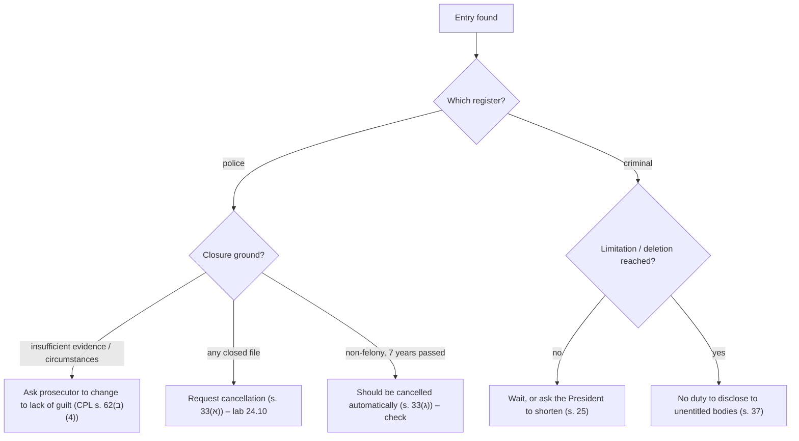

# 24.8 · Criminal records, police records and rehabilitation

This lesson explains what the State keeps about you after a criminal matter ends, who may see it, and when and how it fades: the criminal register of convictions and court orders, the police register of open and closed files and acquittals, the periods of limitation and deletion, the cancellation of police records, and your right not to tell an employer about what the law has put behind you. It is the law most people meet years after the event, when a job, a licence or a visa depends on it.

## Why it matters

> [!WARNING]
> Records law is about lawful rehabilitation. Never lie on a form that legally requires disclosure, and never try to obtain or alter records by improper means. Use the routes in this lesson: inspect your own record, ask for corrections, ask for a change of closure ground or cancellation, and answer questions within what the law requires.

The Criminal Register and Rehabilitation of Offenders Law 1981, which many older sources still cite (its s. 14 on limitation and s. 16 on deletion), was **replaced on 12 July 2022** by the Criminal Information and Rehabilitation of Offenders Law 2019. The new law covers both the criminal register and the police register, sets the periods in one place, lets everyone inspect their own information, and ties the meaning of "closed file" to the closure ground. For a learner it answers practical questions: why a file closed for "insufficient evidence" still shows up, why a non-conviction order is still a record, why an employer may not ask you to bring a "certificate of good conduct", and when you may ask the police to cancel an entry. The idea behind it is the Jewish-law principle of תקנת השבים, the rehabilitation of those who have repented (module 10).

## Key terms

| עברית | Transliteration | English |
|---|---|---|
| מידע פלילי | meida plili | criminal information (both registers) |
| המרשם הפלילי | hamirsham haplili | criminal register (convictions and court orders) |
| המרשם המשטרתי | hamirsham hamishtarti | police register (pending and closed files, stays, acquittals) |
| פרט רישום | prat rishum | record entry |
| התיישנות | hityashnut | limitation (of a record entry) |
| מחיקה | mechika | deletion (of a record entry) |
| תיק סגור | tik sagur | closed file |
| ביטול רישום משטרתי | bitul rishum mishtarti | cancellation of a police record entry |
| תעודת יושר | te'udat yosher | "certificate of good conduct" for abroad |
| תקנת השבים | takanat hashavim | rehabilitation of offenders |

## The law

### Two registers: ss. 8, 27

The **criminal register** contains, for felonies and misdemeanours: convictions and sentences; probation, community-service and undertaking orders, even without conviction; findings of unfitness to stand trial or non-responsibility for mental illness; juvenile findings; and changes by pardon or the President (s. 8(א)). Traffic offences have a separate register (s. 8(ב)); **fine offences and administrative offences are not included** unless the Minister orders otherwise (s. 8(ג)).

The **police register** contains, for felonies and misdemeanours: pending investigations and trials; closed files — a decision not to investigate (s. 59), not to prosecute (s. 62) **except for lack of guilt**, closure by conditional arrangement (s. 67ו), and indictments cancelled by withdrawal or under s. 149(10); stays of proceedings (s. 231); and acquittals (s. 27(א)). ([Criminal Information Law ss. 8, 27](https://he.wikisource.org/wiki/חוק_המידע_הפלילי_ותקנת_השבים#סעיף_27))

### Confidentiality and your own access: ss. 3–4, 7

> (א) מידע פלילי יהיה חסוי ולא יימסר אלא לפי הוראות חוק זה. (ב) לא ידרוש אדם מידע פלילי, במישרין או בעקיפין, שלא בהתאם להוראות חוק זה, לרבות בדרך של תצהיר, הצהרה או שאלון בכתב…

*Gist:* Criminal information is confidential; no one may demand it, directly or indirectly, including by affidavit, declaration or questionnaire, except under the law, and your consent does not make an unentitled person entitled (s. 3). Everyone may inspect the information about himself (s. 4(א)), on a computer screen at a police station of his choice, without photographing or copying it, though he may take notes (s. 4(ג); Inspection Regulations 2022 reg. 2); a lawyer with a special power of attorney may receive a printout for representation before an entitled court or body (s. 4(ד)). Errors are corrected by the police, who notify you (s. 7).

### Limitation and deletion: ss. 18–24

For adults, **limitation** (התיישנות) occurs, counted from the judgment (s. 18(א)), after:

| Situation | Limitation period (s. 19) |
|---|---|
| Conviction or order, no prison, no other entry | 4 years (5 for sexual or violent offences or drug offences) |
| Same, with another entry | 7 years |
| Prison up to 5 years | 7 years plus the prison term |
| Prison over 5 years | 10 years plus the prison term |

**Deletion** (מחיקה) runs from the end of limitation (s. 21(א)), for the same periods without adding the prison term, and five years for orders without conviction (s. 22). After limitation, the entry goes only to the bodies in ss. 10–11 (police, security services, courts in criminal cases, listed authorities); after deletion, only to a narrower list for special reasons (s. 21(ב)). A new entry during the period postpones the end for all entries (ss. 18(ז), 21(ג)); an entry does not age until the full sentence is served (s. 18(ב)). Some serious offences never lapse (s. 24). Minors have shorter periods (ss. 20, 23). The President may shorten or cancel periods (s. 25). A legal disqualification based on an entry lapses on limitation or deletion (s. 26). ([ss. 18–26](https://he.wikisource.org/wiki/חוק_המידע_הפלילי_ותקנת_השבים#סעיף_18); [current numbers](../../references/current-numbers.md))

### Closed files and acquittals: ss. 31–33

Information on closed files and stays goes only to the bodies in the Sixth Schedule (s. 31). Information on an acquittal is not given out, except to listed security and police bodies for listed purposes (s. 32).

> (א) ראש אגף החקירות והמודיעין במשטרה או קצין משטרה בדרגת סגן־ניצב ומעלה שהוא הסמיך לכך רשאים לבטל פרט רישום משטרתי שעניינו תיק סגור, לפי אמות מידה…

*Gist:* The head of the police Investigations and Intelligence Department, or an authorised officer of at least deputy-commander rank, may cancel a police-register entry about a closed file under criteria set by the Ministers with Knesset committee approval, considering the time since the event, the person's age then, personal circumstances, other entries and the seriousness of the offences; cancelling a stay of proceedings needs the Attorney General's consent (s. 33(א)–(ב)). A closed file in an offence that is not a felony is **cancelled automatically after seven years from the event** (five for minors), unless the criteria say otherwise (s. 33(ג)). ([s. 33](https://he.wikisource.org/wiki/חוק_המידע_הפלילי_ותקנת_השבים#סעיף_33); ⚠️ the criteria themselves were not found on a free source: check the police website)

A file closed for **lack of guilt** is removed from the police register (CPL s. 62(ב)(4)); a suspect may ask the prosecutor to change the closure ground (lesson [24.5](lesson-05.md)).

### Questions about your past: ss. 36–38

> (א) אדם אינו חייב לגלות מידע פלילי על עצמו, שהוא פרט רישום שהתיישן או שנמחק, תיק סגור או תיק שעוכבו בו ההליכים, למי שאינו זכאי לקבל את המידע לפי חוק זה.

*Gist:* You need not disclose an entry that has lapsed or been deleted, a closed file or a stayed file to anyone not entitled to receive it, and you bear no criminal or other liability for not doing so, despite any contrary duty in law or contract (s. 37). An entitled body must weigh the information by set criteria (seriousness, time passed, age, other entries, relevance to the right sought) and may not consider it contrary to the law (ss. 36, 38). For a right abroad, the information is sent to the foreign authority through the Foreign Ministry or a foreign embassy, at your request, excluding deleted entries (s. 15(א)); you no longer receive a printout yourself.

## Leading cases

### Key text: the 2019 law and its legislative history

There is little published Supreme Court case law on the 2019 law yet, and the main older rulings on the 1981 law are not freely available. The decisive texts are the statute ([Wikisource](https://he.wikisource.org/wiki/חוק_המידע_הפלילי_ותקנת_השבים)), its publication in the official gazette ([Reshumot PDF](https://fs.knesset.gov.il/20/law/20_lsr_528760.pdf)), and the Inspection Regulations 2022. Read three choices the legislature made, each a debate between public safety and rehabilitation:

- **Two registers instead of one with exceptions.** The police register now has its own list and its own cancellation route (ss. 27, 33), answering the criticism that closed files followed innocent people for life.
- **No printout to the person.** Under the old law people could be pressured by employers to "bring a certificate"; the new law makes the information inspectable only on screen and makes any demand outside the law unlawful (ss. 3–4).
- **Weighing criteria for entitled bodies** (s. 36), so that even an entitled employer must consider time, age and relevance.

### Old law, for older documents

Decisions and forms before 12 July 2022 cite the 1981 law: s. 14 (limitation), s. 16 (deletion), s. 11א (closed files). If you see these, translate them to the 2019 sections (ss. 18–23, 31–33); transitional provisions are in ss. 59–60 of the new law. ([1981 law, Wikisource](https://he.wikisource.org/wiki/חוק_המרשם_הפלילי_ותקנת_השבים))

## How it works in practice

### What each outcome leaves behind

| Outcome | Register | When it fades |
|---|---|---|
| Closed for lack of guilt | None (removed) | Immediately (CPL s. 62(ב)(4)) |
| Closed for insufficient evidence / circumstances / arrangement | Police register (closed file) | Cancellation by request (s. 33(א)) or automatically after 7 years for non-felonies (s. 33(ג)) |
| Acquittal | Police register; not disclosed (s. 32) | Stays, but is almost never given out |
| Non-conviction order (probation, community service) | Criminal register | Limitation after 4–5 years; deletion 5 years later (ss. 19, 22(5)) |
| Conviction with fine only, first entry | Criminal register | Limitation 4 years (5 for sexual, violent, drug), then deletion 4 years later |
| Paid fine-offence notice (parking, traffic tickets on the criminal track; administrative traffic fines since 2026 are not criminal, lesson 37.4) | Not in the criminal register (s. 8(ג)); traffic register for traffic offences | Traffic-register rules |

### Inspecting your own record

1. Go to any police station during the published hours with a biometric ID card (or another listed ID) (Inspection Regulations regs 2, 6).
2. Ask to inspect "מידע פלילי עליי". You will see the criminal and police registers on a screen; you may take notes, not photos.
3. Write down each entry: file number, date, offence, outcome, closure ground.
4. If something is wrong, ask for correction (s. 7); if a closed file is there, consider the routes below.

### Clearing routes

## Worked example

Ahmad Khalil, 31, from Umm al-Fahm, applies for a job as a security guard at a mall and also plans to study in Canada. In 2017 he was questioned about a fight; the file was closed for insufficient evidence. In 2019 he was convicted of malicious damage to a car (a misdemeanour) and fined.

1. **Inspect.** At the station he sees: police register — 2017 closed file (assault, insufficient evidence); criminal register — 2019 conviction, fine.
2. **The 2017 file.** It was a misdemeanour (assault, s. 379). More than seven years have passed since the event, so it should have been cancelled automatically (s. 33(ג)). He asks in writing why it is still shown, citing s. 33(ג). If it had been a felony, he would file a reasoned cancellation request (s. 33(א)) (lab [24.10](lesson-10.md)).
3. **The 2019 conviction.** Fine only, no other entry: limitation 4 years from judgment, so lapsed in 2023; deletion 4 years later, in 2027.
4. **The employer.** A security company may be an entitled body for guard licensing under the schedules; if so, it may receive non-lapsed information, and must weigh it (s. 36). If it is not entitled, it may not ask him to declare anything (s. 3(ב)), and he need not disclose lapsed entries or closed files (s. 37).
5. **Canada.** He asks the police to send his criminal-register information to the Canadian authority through the embassy (s. 15(א)); deleted entries are excluded.

## Do it yourself

### You need

- Criminal Information Law ss. 3–4, 8, 18–27, 31–33, 36–37 (link above).
- Your own record (optional: visit a station) or the Ahmad Khalil case.
- 40 minutes.

### Steps

1. **Classify (10 min).** For five outcomes (lack of guilt, insufficient evidence, conditional arrangement, community service without conviction, conviction with three months' prison), write the register, the date of limitation and deletion or cancellation, and who may see it in the meantime.
2. **Calculate (15 min).** For a conviction with two months' prison on 1 June 2024, and another conviction (fine) on 1 June 2026, calculate when each entry lapses and is deleted, applying ss. 18(ז) and 21(ג).
3. **Employer answer (15 min).** Draft a polite two-sentence reply to a non-entitled employer whose form asks "Do you have a criminal record or open or closed files?", relying on ss. 3(ב) and 37.

### Template

None for this lesson; the cancellation request template is in lab [24.10](lesson-10.md).

### How you know it worked

- Lack of guilt leaves nothing; insufficient evidence leaves a closed file; community service without conviction is in the criminal register.
- In step 2, the second conviction pushes the end of both periods to the later one.
- Your reply does not lie; it states that the law forbids the question and that you need not disclose.

### Self-check

- [ ] I know the 1981 law was replaced on 12 July 2022 by the 2019 law.
- [ ] I know what is in the criminal register and what is in the police register.
- [ ] I know the limitation and deletion periods for a first conviction without prison.
- [ ] I know a non-felony closed file is cancelled after seven years from the event.
- [ ] I know I may inspect my own information at any police station, on screen.

## Without a lawyer

### Can you do this yourself?

Yes. Inspecting your own information, asking for a correction, asking to change a closure ground, requesting cancellation of a police record and asking for information to be sent abroad are all done by the person himself. A pardon or shortening request to the President is also personal, though many use a lawyer. See [can I act without a lawyer](../../references/can-i-act-without-a-lawyer.md).

### Where and how

- Inspection: any police station, published hours, biometric ID (Inspection Regulations).
- Cancellation of a police record: a written request to the police (s. 33); the police publish a form and an online channel (⚠️ manual check on police.gov.il / gov.il, which block bots).
- Change of closure ground: to the prosecutor who closed the file (CPL s. 62(ב)(4)).
- Information for abroad: through the police, the Foreign Ministry or the embassy (s. 15(א)).
- President's pardons department (Ministry of Justice) for shortening periods (⚠️ manual check on gov.il).

### Stop and get a lawyer when

- An entitled body (a licensing authority, the Bar, an employer of children) is weighing your record for a decision.
- An entry is not yours, or shows a conviction you do not recognise.
- You face deportation, a professional licence refusal or a security clearance decision.
- You want to ask the President to shorten periods for a serious offence.

## What goes wrong

| Mistake | Consequence | How to fix | How to avoid |
|---|---|---|---|
| Citing the 1981 law sections | Wrong periods and wrong arguments | Use the 2019 law ss. 18–33 | Check the date of the source |
| Bringing an employer a "record printout" | Unlawful demand met; information disclosed | Refer to s. 3(ב) | The law no longer issues printouts to you |
| Assuming a closed file disappears | Surprise at a licensing or visa check | Request cancellation (s. 33) or change of ground | Check the ground when the file closes |
| Lying on a form that an entitled body may ask | False statement; refusal | Correct in writing | Distinguish entitled from unentitled askers |
| Ignoring a new conviction's effect | Older entries do not lapse (ss. 18(ז), 21(ג)) | — | Know the "latest period wins" rule |

## Review

- Since 12 July 2022 the Criminal Information and Rehabilitation of Offenders Law 2019 governs both registers.
- The criminal register holds convictions and court orders; the police register holds pending and closed files, stays and acquittals; fine offences are not in the criminal register.
- Entries lapse and are deleted after set periods; a new entry postpones the end of all of them.
- Closed files: lack of guilt removes the entry; others can be cancelled on request (s. 33(א)) and non-felonies automatically after seven years (s. 33(ג)).
- No one may demand your record outside the law; you need not disclose lapsed or deleted entries or closed files to unentitled askers (ss. 3, 37).

### Learn more

- Wikisource, חוק המידע הפלילי ותקנת השבים: <https://he.wikisource.org/wiki/חוק_המידע_הפלילי_ותקנת_השבים>. FREE-FULL, 40 minutes (ss. 1–8, 18–37). Fallback: the Reshumot PDF <https://fs.knesset.gov.il/20/law/20_lsr_528760.pdf>.
