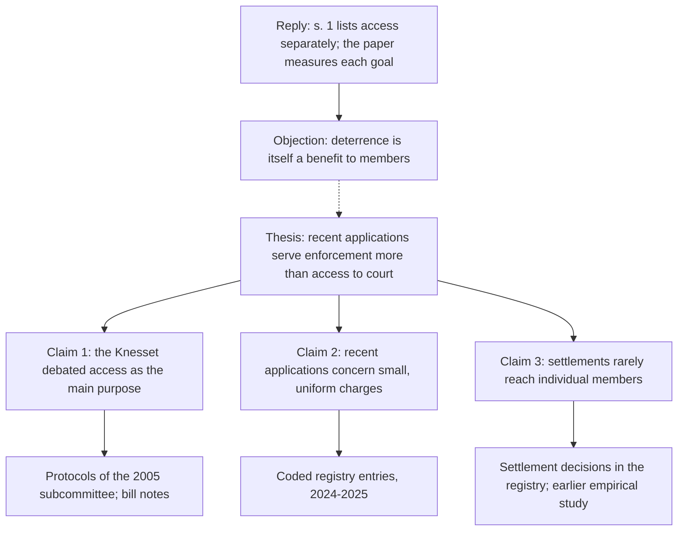

# 36.4 · Writing the long paper: chapters, argument maps and revision

By the end of this lesson you will be able to organise a 30-page paper into chapters with a page budget, keep the whole argument in view with an argument map, manage a hundred sources without losing a pinpoint, and revise in planned cycles instead of rereading endlessly. Lesson [21.3](../module-21/lesson-03.md) gave you the skeleton of a 15-page paper; this lesson is about what breaks when the paper doubles.

## Why it matters

A 15-page paper fits in your head. A 30-page paper does not. Three things go wrong at this length: chapters drift away from the thesis (each becomes a small essay of its own); sources multiply until you cannot find where a quotation came from; and revision turns into polishing sentences in chapter one while chapter four still has no argument. Experienced authors deal with all three by writing tools: a chapter plan with a page budget, an argument map, a reference library and a fixed revision order. None of them needs more than a word processor and free software.

## Key terms

| עברית | Transliteration | English |
|---|---|---|
| פרק / תת-פרק | Perek / tat-perek | Chapter / section |
| מפת טיעון | Mapat ti'un | Argument map |
| תקציב עמודים | Taktziv amudim | Page budget |
| מתווה הפוך | Mitve hafukh | Reverse outline (one line per paragraph, written after drafting) |
| סבב תיקונים | Sevev tikunim | Revision cycle |
| מנהל ביבליוגרפיה | Menahel bibliografya | Reference manager |
| עמוד שער | Amud sha'ar | Title page |

## The law

### Format and the title page (TAU faculty regulations s. 82(ה))

> הפורמט להגשת עבודות פרו-סמינר ועבודות סמינריוניות בפקולטה יהיה כדלהלן: כתב: David; גודל: 12; רווח בין שורות: שורה וחצי.

> בכותרת עמוד השער של עבודה סמינריונית יצוינו שם הקורס, שם המרצה, תאריך ההגשה, שם התלמיד, מספר זהות, ומספר המילים בעבודה (כולל הערות שוליים).

*Gist:* Proseminar and seminar papers are submitted in David 12 point with 1.5 line spacing (the same rule sets 2 cm top and bottom margins and 2.5 cm side margins), and the title page states the course, the lecturer, the submission date, the student's name and ID number, and the word count including footnotes. ([TAU Faculty of Law study regulations 2016–17, s. 82(ה)](https://yedion-law.tau.ac.il/sites/law.tau.ac.il/files/media_server/law_heb/yedion2016-17/takanon2016-7.pdf)) This is the latest full edition the course could open; your faculty's current rules and your seminar's syllabus prevail. Note the practical point: word counts include footnotes, so a 30-page text with heavy footnotes can exceed a word limit.

### Citation format

The uniform citation rules, third edition (2021), still apply (checked on the [TAU rules page](https://law.tau.ac.il/izkur) on 2026-10-18). Lesson [21.4](../module-21/lesson-04.md) covers them; nothing changes at seminar level except volume and consistency.

## Leading cases

No ruling governs paper structure. The model is a long paper whose table of contents is its argument.

### קרן וינשל-מרגל ואלון קלמנט "יישום חוק תובענות ייצוגיות בישראל – פרספקטיבה אמפירית" משפטים מה 707 (2016)

The table of contents on the first page: מבוא; א. the legal and theoretical background in four steps (the enactment of the Law, its goals, the representative problem and meritless claims, how to measure efficiency); ב. method; ג. findings and discussion in four steps (filing trends, outcomes of applications, use of the Law's special mechanisms, costs); סיכום. Why it matters: each part prepares the next. The theory chapter defines the four goals that the findings chapter then measures, and the method chapter sits between them. A reader can follow the whole argument from the contents alone, which is the test your own chapter plan should pass. [Free PDF](https://law.tau.ac.il/sites/law.tau.ac.il/files/media_server/law_heb/Tovanot/Articles/1481038186i86JF.pdf)

## How it works in practice

### A chapter plan with a page budget

| Part | Pages | Job |
|---|---|---|
| א. מבוא | 2 | Hook, question, thesis, contribution (the gap sentence from [36.1](lesson-01.md)), roadmap |
| ב. Framework and method | 4–5 | The law as it stands; the literature; the method and its limits ([36.2](lesson-02.md)) |
| ג. First step of the argument | 6–7 | Often the primary-source chapter: legislative history ([36.3](lesson-03.md)) or doctrine |
| ד. Second step | 6–7 | Often the data or comparison chapter |
| ה. Third step or synthesis | 4–5 | What ג and ד show together |
| ו. Counter-arguments and proposal | 3–4 | The strongest objections; your proposal and its costs |
| ז. סיכום | 1–2 | The answer; limits; further research |

Write the budget next to each heading in your draft. When a chapter runs over by more than a page, decide what to cut before you write further, not at the end.

### The argument map

An argument map is a diagram of your thesis, the claims that support it, the sources behind each claim, and the objections. Draw it before the first draft and update it after each revision cycle. A claim with no source under it is a gap; an objection with no reply is a weakness; a chapter that appears nowhere on the map does not belong in the paper.

Paper and pencil, a whiteboard or any free diagram tool works just as well.

### A reference manager, and its limits

A reference manager stores your sources, PDFs and notes in one searchable library and inserts citations into the word processor. **Zotero** is free and open source; the current version on 2026-10-18 was 10.0.6, with plugins for Microsoft Word, LibreOffice and Google Docs ([word processor integration](https://www.zotero.org/support/word_processor_integration)).

**There is no Israeli citation style for it.** Zotero formats citations with styles written in the Citation Style Language (CSL). On 2026-10-18 the official CSL styles repository (over 10,000 files) contained no style for the Israeli uniform citation rules; it does contain Bluebook and OSCOLA styles. So, for a Hebrew legal paper:

- **Use Zotero as a library**: one item per source, with the PDF attached, your pinpoint notes, tags by chapter, and the access date for web sources.
- **Write Hebrew footnotes by hand** in the format of the uniform rules, copying the details from the library item.
- **For English sources**, a Bluebook style can produce a first draft of the citation, which you then check against the source and the rules (lesson 21.4).
- **Never trust automatic metadata** for Israeli rulings or Knesset documents; enter the case number, parties and date yourself from the court's site.

A spreadsheet with one row per source (the literature map from [21.2](../module-21/lesson-02.md)) is an acceptable alternative; what matters is that every pinpoint is recorded once and found in seconds.

### Files and versions

- One file per chapter while drafting; merge for the full draft.
- Name versions by date: `seminar-ch3-2026-11-14.docx`. Never overwrite the last version your supervisor saw.
- Keep a "cuts" file. Text you remove goes there, so cutting is not losing.
- Back up to a second place every day you write.

### Three revision cycles, in this order

1. **Structure.** Write a reverse outline: one line per paragraph, stating its point. Check it against the argument map and the page budget. Move, merge or delete paragraphs. Do not fix sentences yet.
2. **Paragraphs and transitions.** Each paragraph opens with its point; each chapter ends with a mini-conclusion that leads to the next; the roadmap in the introduction matches the headings.
3. **Sentences and footnotes.** Cut words, fix terms used inconsistently, then do the footnote pass (full citation at first mention, short forms, signals, pinpoints) and the integrity check ([21.5](../module-21/lesson-05.md)).

Leave at least two days between cycles. Fresh eyes find structural problems that tired ones explain away.

## Worked example

Anastasia Belova, a student from Haifa, has 34 pages of draft on comparative rules for representative actions in Israel and England, a week before her peer review.

1. **Reverse outline.** Her 71 paragraphs produce 71 lines. Eleven lines in chapter ד describe English procedure without saying anything about Israel.
2. **Argument map.** Chapter ד's claim ("the English opt-in rule explains its low use") has two English sources under it but no link to her thesis about Israeli settlements. She adds a final section to ד comparing the two systems' settlement approval rules, and cuts six paragraphs of English history to her cuts file.
3. **Page budget.** Chapter ב had grown to eight pages against a budget of five. She moves the literature review on English law into ד, where it is used.
4. **References.** Her Zotero library has 63 items. Searching the tag "ch4" shows every source of chapter ד; two items have no pinpoint note, and she reopens their PDFs.
5. **Footnotes.** She writes the Hebrew footnotes by hand. For the English cases she uses a Bluebook style as a draft and corrects two citations the style formatted from wrong metadata.
6. **Result.** 30 pages, a contents page that reads as an argument, and a version file dated before the peer review.

## Do it yourself

### You need

- Your seminar research plan (36.1), method (36.2) and worksheet (36.3), or a draft of at least 10 pages.
- A word processor; optionally Zotero (free) from the [download page](https://www.zotero.org/download/).
- The [proseminar paper outline](../../templates/proseminar-paper-outline.md), part C (skeleton) and part D (source list).
- 90 minutes.

### Steps

1. Write your chapter plan with a page budget and a one-sentence claim for each chapter (20 minutes).
2. Draw the argument map: thesis, three to four claims, the sources under each, the two strongest objections and your replies (25 minutes).
3. Mark every gap on the map: a claim without a source, an objection without a reply (5 minutes).
4. Set up your reference library: Zotero (create a collection for the paper and one sub-collection per chapter) or a spreadsheet; enter your ten most important sources with pinpoint notes (25 minutes).
5. If you already have a draft, write a reverse outline of one chapter and compare it with the map (15 minutes). Otherwise, write the revision calendar: dates for the three cycles.

### Template

[Proseminar paper outline](../../templates/proseminar-paper-outline.md), parts C and D, used with a 30-page budget; [seminar research plan](../../templates/seminar-research-plan.md), part C (timeline).

### How you know it worked

- Reading only your chapter claims gives the argument in order.
- Every claim on the map has at least one primary source under it.
- You can find the pinpoint of any of your ten key sources in under a minute.
- Your revision calendar finishes before the peer-review date.

### Self-check

- [ ] My chapter plan adds up to the page or word limit, footnotes included where the rules count them.
- [ ] The map shows at least one objection with a reply.
- [ ] I know my reference manager will not format Hebrew legal footnotes for me.
- [ ] I keep dated versions and a cuts file.

## Without a lawyer

### Can you do this yourself?

Not a filing lesson. Planning and revising long documents is a writing skill, and it carries over directly to your own long filings: a statement of claim with many causes of action, an appeal, or summations after a trial.

### Where and how

Before drafting a long filing, write a one-line claim for each section and map each claim to its evidence (exhibit numbers, affidavit paragraphs) and its legal source; the [research memo](../../templates/research-memo.md) template is a good container. Then run the same three revision cycles. Court rules often limit length and format; check the procedure rules for your forum (lesson [15.2](../module-15/lesson-02.md) for civil pleadings) before you budget pages.

### Stop and get a lawyer when

The filing has grown beyond what you can keep accurate (many parties, many causes of action, or a long trial record), or the court has already criticised your filings for length or structure.

## What goes wrong

| Mistake | Consequence | How to fix | How to avoid |
|---|---|---|---|
| No page budget | One chapter swallows the paper; the argument chapters are thin | Cut the overgrown chapter now, to the cuts file | Budget pages per chapter before drafting |
| Chapters as separate essays | No thesis running through the paper | Rewrite each chapter's opening and closing to link to the thesis | Keep the argument map beside the draft |
| Expecting Zotero to produce Israeli footnotes | Wrong format throughout | Write Hebrew footnotes by hand from the library item | Use the manager as a library, not a formatter |
| Polishing sentences before structure | Hours lost on text that is later cut | Do the reverse outline first | Follow the three-cycle order |
| Overwriting versions | Cannot recover cut text or show progress | Restore from backup | Date-stamped versions and a cuts file |
| Word count ignores footnotes | Over the limit at submission | Trim footnotes that carry no source | Check whether your rules count footnotes |

## Review

- Plan the long paper as chapters with a page budget, each chapter one step of the argument.
- Draw an argument map: every claim needs a source, every objection a reply, every chapter a place on the map.
- Zotero (10.0.6 on 2026-10-18) is a good free library, but no CSL style for the Israeli uniform rules exists; write Hebrew footnotes by hand.
- Revise in three cycles: structure (reverse outline), paragraphs, then sentences and footnotes.
- Check format and word-count rules early; at TAU the title page states the word count including footnotes.

### Learn more

- [Zotero quick start guide](https://www.zotero.org/support/quick_start_guide) (FREE-FULL, 20 minutes): collections, tags, notes and the word-processor plugin. Fallback: [word processor integration](https://www.zotero.org/support/word_processor_integration).
