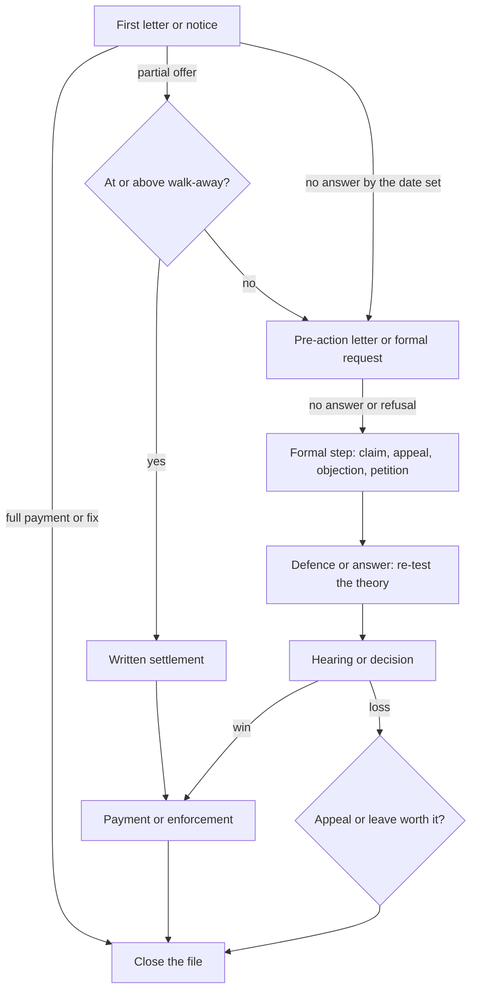

# 39.2 · The case theory and the strategy map

A file without a theory is a pile of documents; a theory without a map is a hope. In this lesson you write the case theory of your capstone matter, the short account that joins your facts to the legal rule and to the remedy you want, and you test it against the other side's best version. Then you draw the strategy map: the routes open to you, the decision points where you will choose between them, the trigger for each move, the numbers that set your walk-away figure, a timeline counted back from the fatal deadline, and the risks that could sink the matter.

## Why it matters

In every clinic you followed a track the lesson chose for you: letter, claim, hearing, enforcement. In a real matter the tracks branch. A demand letter may bring a partial offer, a regulator may help or stall, a represented opponent may raise a threshold objection, a key document may turn out to be in the other side's hands. People who act without a plan react to each event as it comes, and they usually react late or emotionally. A strategy map decides in advance, in a calm hour, what each event will mean.

The case theory is the centre of the map. Judges in small claims, the labour court's expedited track and the tribunals have minutes, not hours, for your matter. The litigant whose story, rule and remedy fit on one page, and who has already answered the obvious objection, is the one whose case the judge understands. Lesson [02.6](../module-02/lesson-06.md) taught you to answer a legal question in a research memo; the case theory is the advocate's version: not "what is the law?" but "why should this decision-maker give me this remedy?"

## Key terms

| עברית | Transliteration | English |
|---|---|---|
| תאוריית התיק | te'oriyat ha-tik | case theory |
| עילת תביעה | ilat tvi'a | cause of action |
| יסודות העילה | yesodot ha-ila | elements of the cause of action |
| נטל ההוכחה | netel ha-hokhacha | burden of proof |
| טענות הגנה | te'anot hagana | defences |
| קיזוז | kizuz | set-off |
| נקודת החלטה | nekudat hachlata | decision point |
| נקודת יציאה | nekudat yetsi'a | walk-away figure |
| שימוש לרעה בהליכי משפט | shimush le-ra'a be-halikhei mishpat | abuse of process |

## The law

A case theory is built from the rule that gives the right. For your matter the rule is in the lessons the cross-index of lesson [39.1](lesson-01.md) points to. Here are the two rules behind this module's worked examples, and the procedural rules that limit every strategy.

### Samira's rule: resignation that counts as dismissal

> התפטר עובד מחמת הרעה מוחשית בתנאי העבודה, או מחמת נסיבות אחרות שביחסי עבודה לגבי אותו העובד שבהן אין לדרוש ממנו כי ימשיך בעבודתו, רואים את ההתפטרות לענין חוק זה כפיטורים.

*Gist:* A resignation because of a material deterioration in conditions, or circumstances in which the employee cannot be expected to continue, counts as dismissal for severance pay. ([Severance Pay Law s. 11(א)](https://he.wikisource.org/wiki/חוק_פיצויי_פיטורים)) The courts generally expect the employee to have warned the employer and given it a chance to put things right (lesson [17.4](../module-17/lesson-04.md)). The elements therefore are: employment for the qualifying period, a deterioration that is material, a causal link to the resignation, and a prior warning.

### Tsega's rule: the contractor's defect

> (א) לא תיקן הקבלן את הפגם תוך זמן סביר לאחר שהמזמין עשה כאמור בסעיף 3(א), רשאי המזמין – (1) לתקן את הפגם ולדרוש מהקבלן החזרת הוצאותיו הסבירות; (2) לנכות מן השכר, כל עוד לא תוקן הפגם, את הסכום שבו פחת שווי המלאכה או השירות עקב הפגם [...]

*Gist:* If the contractor does not repair within a reasonable time after the customer notified him and gave him a chance to repair (s. 3(א)), the customer may repair and recover reasonable costs, or deduct the loss of value from the price. ([Contract for Services Law s. 4(א)](https://he.wikisource.org/wiki/חוק_חוזה_קבלנות)) Elements: a contract for work, a defect (work not as agreed), timely notice with a chance to repair, failure to repair, and the reasonable cost.

### Limits on any strategy

> לא יעשה בעל דין או בא כוחו שימוש לרעה בהליכי משפט ובכלל זאת פעולה בהליך שמטרתה או תוצאתה לשבשו, להשהותו או להטריד בעל דין…

*Gist:* A party may not abuse the process, including by a step whose purpose or effect is to disrupt, delay or harass, or that is disproportionate to the case. ([Civil Procedure Regulations reg. 4](https://he.wikisource.org/wiki/תקנות_סדר_הדין_האזרחי)) Regulation 3 requires good faith and cooperation, and reg. 153(ג) lets the court weigh what you claimed against what you won when it sets costs (lesson [11.5](../module-11/lesson-05.md)). A strategy built on inflating the claim to "anchor", on burying the other side in motions, or on threats does not just fail; it costs money.

## Leading cases

### בש״א 6479/06 בנק דיסקונט לישראל בע״מ נ׳ שנפ (15.1.2007)

Decided under the old rules, this decision states the standard the 2018 Regulations now codify in regs 3–4: a litigant must act as a reasonable and decent litigant would, protecting its own interest while respecting the other parties' justified procedural expectations and its duties to the court. Why it matters for the strategy map: every route on your map must be one a reasonable and decent litigant would take. "Make them tired" is not a route. Free summary and quotation: [Hebrew Wikipedia, שימוש לרעה בהליכי משפט](https://he.wikipedia.org/wiki/שימוש_לרעה_בהליכי_משפט) (⚠️ secondary source).

### רע״א 1954/24 וקנין נ׳ קיבוץ ניר דוד (7.1.2025)

The Supreme Court held that a defamation claim against an activist was a SLAPP, an abuse of process that a court may dismiss at the threshold or answer with costs correlated with the sum claimed; among the indicators it listed were an inflated damages claim, a borderline cause of action and a power gap between the parties. Why it matters for the case theory: the remedy you claim is part of your credibility. Claim what your elements and documents support, and keep the theory proportionate to the harm; the same indicators that sink a powerful plaintiff's SLAPP make a small plaintiff's exaggerated claim look weak. Free summary: [Hebrew Wikipedia, תביעת השתקה](https://he.wikipedia.org/wiki/תביעת_השתקה) (⚠️ secondary source; the full text is on the Judiciary's site, which could not be reached for this course).

## How it works in practice

### Writing the case theory

A case theory has three parts and a theme:

1. **The facts story,** in one or two sentences a judge could repeat: who did what, when, and what it cost you. No adjectives you cannot prove.
2. **The legal rule:** the section that gives the right, the section that imposes the duty, and the section that gives the remedy.
3. **The remedy:** a sum, an act, a decision or a correction, precise enough to write into an order.
4. **The theme,** in three or four words, that captures why the outcome is fair ("a transfer that ended the job"; "paid for a floor that leaks").

Test it five ways before you rely on it:

| Test | Question |
|---|---|
| Consistent | Does it fit every fact the other side cannot dispute (dates, documents, payments)? |
| Complete | Does every element of the rule have a fact, and every fact a document or witness? |
| Explains the bad facts | What is the worst fact for you, and does the theory account for it? |
| Simple | Can you say it in under a minute without notes? |
| Proportionate | Does the remedy match what the documents prove? |

### The other side's theory

Write the other side's version in its strongest form, as its lawyer would. Then list the legal defences it may raise: limitation, the wrong forum, no standing, a contract term or exclusion, a statutory exception, set-off, a counterclaim. For each, write your answer, or a concession and how it changes your remedy. A concession made now, in your own file, is a strength; the same concession extracted at the hearing is a defeat.

### The strategy map

Every arrow is a **trigger** you define in advance: a number of days without an answer, a refusal, an offer above or below your walk-away figure, a defence that raises something new. Every box has a **deadline** and a **fallback**. Side routes go on the map too: a regulator or oversight complaint (useful pressure, but it never stops a limitation period; lessons [12.4](../module-12/lesson-04.md) and [37.6](../module-37/lesson-06.md)), mediation (lesson [08.6](../module-08/lesson-06.md)), a public review or a call to the manager (useful, but only after you have written down what you will and will not say).

### The numbers and the walk-away figure

For a money matter, run the [should-you-sue worksheet](../../templates/should-you-sue-worksheet.md) of lesson 11.5 and copy its results into the map: expected value, the other side's expected cost of defending, the settlement range, and your walk-away figure. For a non-money matter (a decision, a registration, a record), write what the result is worth to you and what it will cost in fees, days and stress. Fees and periods: [current numbers](../../references/current-numbers.md).

### The timeline, counted backwards

Start from the last fatal date: limitation, the appeal period, the objection period, the court's deadline. Count back: the filing must be ready two weeks before; the evidence a month before; the records requests before that. Then compare with today. If the backward timeline starts in the past, you are already late and the map must say what you will drop.

### The risk register

List the four or five things most likely to go wrong (a represented opponent with threshold objections, a counterclaim or a request for security for costs, a missed deadline, a key document you do not hold, a witness who will not come) with what you will do to reduce each and what you will do if it happens. One of your answers will almost always be "run part א of the get-a-lawyer checklist again".

## Worked example

**Samira's theory.** *Story:* "After six years at the Haifa branch, the company closed it and ordered me to work in Karmiel, two hours a day on the bus away from my children's school; I asked in writing to stay in Haifa or be dismissed, got no answer, and resigned because of the transfer." *Rule:* Severance Pay Law s. 11(א) treats such a resignation as dismissal; s. 1 gives severance; her pension arrangement under s. 14 covers only part of it (lesson 17.4). *Remedy:* the severance top-up, about ₪25,900, with linkage and interest. *Theme:* "a transfer that ended the job."

*The other side's best version:* her contract says the company "may transfer the employee to any of its branches"; Karmiel is within the region; it offered to pay her bus fares; she resigned within three weeks without waiting for an answer. *Her answers:* a transfer clause does not let the employer make a change so large that the employee cannot be expected to continue (s. 11(א) speaks of the circumstances, not the contract); the travel time, not the fare, is the deterioration; her letter of 10 July gave the company a chance to keep her in Haifa or to dismiss her, and it chose silence. *Concession:* she will not claim notice pay, because she gave notice and was paid for it.

*Map:* letter to the company's management (lesson [17.10](../module-17/lesson-10.md)) with 14 days to answer; no regulator route for severance; on refusal or silence, a claim in the Haifa regional labour court on the expedited track, since the sum is within the ceiling ([current numbers](../../references/current-numbers.md)); a defence will probably raise the transfer clause, so her research file (lesson 39.3) must cover how the labour courts read such clauses. *Numbers:* with $p = 0.55$ and $c = 0.95$ she computes an $EV$ of about ₪10,600 after the fee, a modest costs risk and three days of her time; the company's expected cost of defending, with its lawyer, is about ₪22,000. She sets her walk-away figure at ₪12,000. *Risk register:* the company's lawyer argues the claim belongs on the ordinary track (reply: it is within the ceiling; reg. 26(א) lets her waive any excess); the manager denies receiving her 10 July letter (she sent it by email and kept the delivery receipt).

**Tsega's theory.** *Story:* "I paid a contractor to build a waterproofed shower floor sloped to the drain; the floor has no slope and part of the waterproofing is missing, so water leaks into the flat below; I told him, he came once, blamed the pipes and stopped answering." *Rule:* Contract for Services Law ss. 3–4: after notice and a reasonable chance to repair, she may repair and recover the reasonable cost, or deduct from the price. *Remedy:* first draft: ₪16,800 (repair quote) + ₪2,400 (the downstairs ceiling she paid for) + ₪450 (the plumber's report) = ₪19,650. *Theme:* "paid for a floor that leaks."

*The other side's best version:* "The leak is from the building's pipes; she never gave me a proper chance; and she still owes me ₪6,000." The last point is strong: she withheld the final ₪6,000 of the price. *Her answer and concession:* the plumber's report shows the pipes were tested and hold pressure, and photographs show the missing waterproofing; her written notice (lesson 39.4) will give him a fixed date to repair; and she concedes the unpaid ₪6,000, which she is entitled to keep as a deduction (s. 4(א)(2)) but must net off the claim. *Revised remedy:* ₪16,800 − ₪6,000 + ₪2,400 + ₪450 = **₪13,650**. The concession makes the claim smaller and much harder to attack.

*Map:* a written notice of the defect with ten days to repair; if he repairs properly, close; if he does not, a pre-action letter with seven days; then a small claim (she is an individual and the sum is within the ceiling). *Numbers:* $p = 0.8$, $c = 0.8$ (he is self-employed and still advertises), $EV$ about ₪7,150 after the fee and two days of her time. Walk-away: ₪9,000, or a proper repair by a different contractor at his expense. *Risk register:* he claims she prevented him from repairing (she will offer two dates in writing); the court wants an expert (she asks the plumber for a signed report with photographs now, lesson 39.3).

## Do it yourself

### You need

- Your capstone file from lesson 39.1.
- The lessons the cross-index named for your matter, for the rule and its elements.
- The draft [capstone strategy map](../../templates/capstone-strategy-map.md), parts ב–ח, and the [should-you-sue worksheet](../../templates/should-you-sue-worksheet.md) for a money matter.
- About 150 minutes.

### Steps

1. **The rule (20 min).** From the lessons for your matter, write the right, the duty and the remedy sections, and list the elements.
2. **The story (15 min).** Write the facts story in two sentences, then the theme in four words.
3. **Elements and proof (20 min).** For each element, the fact and the document or witness you hold. Grade each 1–3. Mark the gaps: they are the work list for lesson 39.3.
4. **The other side (20 min).** Write its version fairly and list its likely defences. Answer each or concede and adjust the remedy.
5. **Test (10 min).** Run the five tests; rewrite the theory until it passes.
6. **Routes and triggers (25 min).** Draw your map: boxes, arrows, triggers, deadlines, fallbacks; side routes and whether they stop any clock (usually not).
7. **Numbers (20 min).** For a money matter, the worksheet and your walk-away figure; otherwise, the value and the cost in fees, days and stress.
8. **Timeline and risks (20 min).** Count back from the last fatal date; write the risk register with five entries.

### Template

- [Capstone strategy map (draft)](../../templates/capstone-strategy-map.md), parts ב–ח. New in this module.
- [Should you sue? decision worksheet](../../templates/should-you-sue-worksheet.md) (lesson 11.5).

### How you know it worked

- You can say your theory aloud in under a minute, and a friend can repeat it.
- Every element has a fact and a graded piece of proof, and every gap is on a work list.
- The map shows what you will do on each likely answer, with the day you will do it.
- Your walk-away figure, or the minimum acceptable result, is written down before any contact with the other side.

### Self-check

- [ ] I wrote the other side's best version in words its lawyer would accept.
- [ ] I made at least one honest concession and adjusted the remedy.
- [ ] I know which routes stop a limitation period and which do not.
- [ ] My backward timeline starts today or later.

## Without a lawyer

### Can you do this yourself?

Yes. Planning your own matter is not a reserved act; it is what every self-represented party does. What s. 20 reserves is doing it for others as an occupation or for payment. If you show your map to a lawyer for a one-time consultation, the advice is the lawyer's; the map stays yours.

### Where and how

> [!IMPORTANT]
> Act in your own name only. This is not legal advice — check current rules before filing.

- No filing in this lesson.
- A one-hour consultation is most useful at this point, with the map and the one-page summary from the [get-a-lawyer checklist](../../templates/get-a-lawyer-checklist.md) in hand (lesson [35.5](../module-35/lesson-05.md) on choosing and briefing a lawyer).
- Free help: Legal Aid where you qualify, the court information centres, university clinics ([where to get help](../../references/where-to-get-help.md)).

### Stop and get a lawyer when

- Your theory depends on a point of law the lessons call contested, and the other side is represented.
- The other side's best version includes a counterclaim larger than your claim.
- The backward timeline starts in the past and the deadline is fatal.
- The map has no route that you can run without an expert opinion you cannot obtain.

## What goes wrong

| Mistake | Consequence | How to fix | How to avoid |
|---|---|---|---|
| A theory that ignores the worst fact | The other side opens with it and the judge stops listening | Rewrite the theory to explain the fact or concede it | Test "explains the bad facts" |
| Claiming the most you can imagine | Credibility lost; costs under reg. 153(ג) | Amend to what the documents prove | Test "proportionate" |
| Forgetting set-off (unpaid price, a deposit already returned) | The claim looks dishonest when the other side raises it | Net it off openly | Write the other side's money claims first |
| A map with no triggers | You react late and emotionally | Add a day count and an action to every arrow | Decide every trigger before contact |
| Treating a regulator complaint as a pause | Limitation runs on | File the claim in time | Mark every side route "does not stop the clock" unless a law says it does |

## Review

- A case theory is the facts story, the legal rule and the remedy, held together by a short theme, and it must pass five tests: consistent, complete, explains the bad facts, simple, proportionate.
- Write the other side's strongest version and answer or concede each point before it is raised against you.
- The strategy map turns events into decisions: every route has a trigger, a deadline and a fallback.
- The walk-away figure and the backward timeline are written before any contact with the other side.
- Reasonable and decent litigation (regs 3–4) is a limit on every strategy; inflated claims cost credibility and costs.

### Learn more

- Hebrew Wikipedia, שימוש לרעה בהליכי משפט: <https://he.wikipedia.org/wiki/שימוש_לרעה_בהליכי_משפט>. FREE-FULL, 15 minutes (the standard of the reasonable and decent litigant). Fallback: Civil Procedure Regulations regs 3–4 on [Wikisource](https://he.wikisource.org/wiki/תקנות_סדר_הדין_האזרחי).
